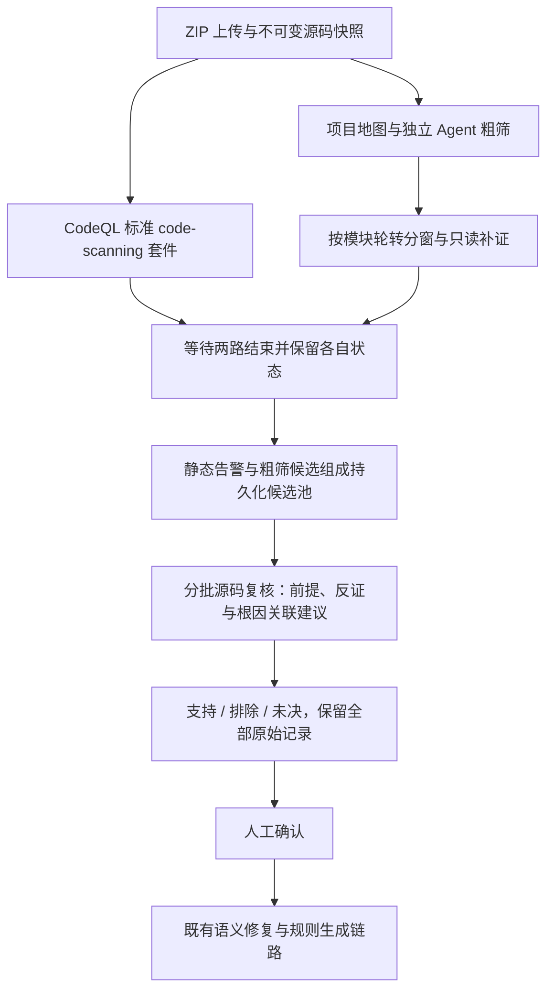

# 双引擎发现实现与开发测试结果

2026-10-05。用户批准的 CodeQL＋独立 Agent 粗筛方案已完成首版实现。**流程已接通；真实模型效果仍不稳定，不能宣称双引擎准确率已显著提高。**

## 1. 当前实际执行链

- 新上传采用 pipeline v2；CodeQL 默认标准套件，不启用 security-extended。历史任务重试保留原 suite/pipeline 配置。
- 粗筛没有静态告警输入，不依赖危险关键词锚点。覆盖选中语言源码窗口，调查权限、所有权、租户、状态、输入与输出条件；允许只读源码、搜索、调用线索补证。
- 项目地图是确定性文件/模块清单及 Python AST 声明、导入线索；不是完整业务模型或解析后的跨框架调用图。
- 两个 LangGraph 分支并发，汇合等待两路完成。单路失败保留另一分支结果；CodeQL 失败不会被记为空告警成功。
- 新 review v4 分批核查两路候选。支持/排除须引用实际目标源码，排除另需实际反证；未核实必要前提不能给出武断结论。粗筛的未知项应在复核时重新评估。
- 原始粗筛、复核副本与人工决定均保留。相同候选身份可在界面折叠，完整历史可展开；根因关联仅为建议，不自动删除、合并或减少漏洞数量。
- 断点材料、候选池、调用预算、源码窗口、未知范围和失败批次均保存。默认最多 24 个粗筛窗口、每窗口 3 步，阶段最多 24 次调用，受时间/token上限约束；大项目可能仅部分覆盖。
- 不自动确认新漏洞，不启动被审计服务，不执行漏洞利用。确认后的候选继续使用既有修复和规则生成模块；本次没有证明所有新增业务缺陷都能转为可用 QL。

## 2. 工程验证

- 普通代码/API回归：**157 项通过**。
- CLI集成：**2 项通过**，使用真实 CodeQL、Docker、PostgreSQL 与 LangGraph 检查点；模型是测试替身，验证流程而非真实模型准确率。
- 前端 TypeScript 与 Vite 生产构建通过，新增模块定向 Ruff 与 `git diff --check` 通过。
- 新测试覆盖无静态锚点发现、跨审计来源隔离、并发汇合、单路失败、预算/窗口缺口、证据位置、复用读取、排除反证、未知前提、候选历史与可选根因关联拒绝。
- 最后一次真实模型实验后，修正了“无效可选根因关联阻断整批有效判断”；同时限制临时补充发现保持待核实状态，不能绕过前提检查直接标为支持。两项修正有普通回归覆盖，未计入下面真实模型实验的效果提升，原失败结果保留。
- 本地既有 Worker 在确认空闲后温和重载，API健康检查与 Worker ping通过。没有执行GUI测试，待用户按验收清单检查。

## 3. 真实模型开发测试

模型：`deepseek-v4.1-flash`，冻结源码和模型配置。三组自建业务条件正反例共六个源码项目，最终一轮；CodeQL标准套件实际执行，没有服务启动或利用重放。最终样例包含完整 `host.py` 调用入口、服务端对象及业务说明。金标签只供评价，不传入检测器。

| 样例 | CodeQL告警 | 粗筛提出目标疑点 | 复核目标结果 | 并发发现耗时 | 复核耗时 |
|---|---:|---|---|---:|---:|
| 缺少订单所有权检查 | 0 | 是 | supported | 15.41 s | 7.91 s |
| 缺少租户隔离检查 | 0 | 是 | insufficient | 15.28 s | 14.87 s |
| 缺少支付状态前置检查 | 0 | 是 | insufficient | 14.93 s | 22.13 s |
| 有订单所有权检查 | 0 | 是，有待证实的额外假设 | 无目标 supported，部分批次未完成 | 20.80 s | 19.47 s |
| 有租户隔离检查 | 0 | 是，有待证实的额外假设 | 无目标 supported，多项未决 | 14.42 s | 18.61 s |
| 有支付状态前置检查 | 0 | 未提出该目标，提出其他疑点 | 无目标 supported，多项未决 | 15.78 s | 31.18 s |

**可以支持的判断：**

1. 独立粗筛确实突破了“静态告警/关键词锚点决定调查入口”的限制，三个正例都提出了相应源码疑点。
2. 最终复核只有 **1/3 正例**取得模型支持，另外两个仍属漏报/未决。所有权样例有三条支持记录，实际对应同一个条件，不能计为三个新增漏洞；也未自动人工确认。
3. 三个反例都没有目标漏洞的 supported 结论，**不能据此记为3/3正确排除或100%精确率**：有未完成批次，许多判断未决，粗筛仍产生额外噪声。最终共有23条粗筛候选；还需要独立逐根因标注。
4. 并发发现中位耗时 **15.35秒**，复核中位耗时 **19.04秒**。仅适用于几行源码的小样例与当前本机缓存；不能外推真实仓库速度，也不证明比旧流程更快。
5. 旧 review v2 在这六个无静态告警、无关键词锚点项目上均因没有入口而失败。该对照说明入口覆盖差异，不能视为普遍竞品准确率比较。

### 失败轮次与修正

保留了四轮原始记录，未挑掉失败结果：

- `dual-discovery-20261005`：独立粗筛有线索；复核重复读取已提供源码，停在未完成。
- `dual-discovery-corrected-20261005`：增加窗口EOF与复用读取反馈；仍出现 supported 与 missing_premises 冲突，结构契约拒绝结论。
- `dual-discovery-entrypoints-20261005`：新增完整调用入口源码，输出更完整，但三个正例均为未决。**这轮与前两轮源码不同，不能做严格前后效果对照。**
- `dual-discovery-final-20261005`：同上一轮完全相同六个项目，明确已有证据应消解粗筛未知、源码层判断边界、可读文件清单；模型支持正例由0/3到1/3。每种配置仅一轮，属于开发反馈，不能归因于某个单独组件或宣称稳定收益。

最后一轮的输入及实现冻结核验通过。完整原始报告、源码包、材料与模型调用记录保存在仓库忽略的 `artifacts/benchmarks/dual-discovery-*/`；最终目录另有 `scout-results.json`。可分享的汇总为 [JSON结果](dual-engine-development-summary.json)。

## 4. 尚需提升的方向

1. **复核结论分层**：目前模型仍把“快照内缺少必要检查”与“部署环境已证明可利用”混在一起，产生任意外部包装层/生产配置未知，压低有效发现。下一步应把源码条件支持程度、真实调用可达性与部署未知分开表达，并为每个必要前提安排具体取证；未知不能直接排除。
2. **有效候选与噪声成本**：安全样例也产生许多未决疑点。增加有保护的反例、跨文件保护、不同框架实现和独立根因人工标签；分别统计疑点召回、复核通过、误排、未决与每个新增根因成本。
3. **范围与去重**：当前模块轮转分窗不是全项目语义理解；默认预算限制大项目覆盖。需要基于持久化地图安排多批调查，保留遗漏，补跨批根因关联。当前关联只在批内，不自动归并。
4. **外部有效性**：本次六个自建案例是开发检查，未完成公开真实仓库/独立基准的总体效果对照。后续冻结未参与调试的测试项目及模型配置，比较 CodeQL单独、Agent单独、两路未复核、两路复核，按语言/框架/漏洞类型分层。

本阶段交付是可检查的双路发现与统一复核实现。已经有“CodeQL未报告→Agent提出→源码复核支持”的真实小案例证据；广泛、稳定的新漏洞检测能力仍需要后续工作。
