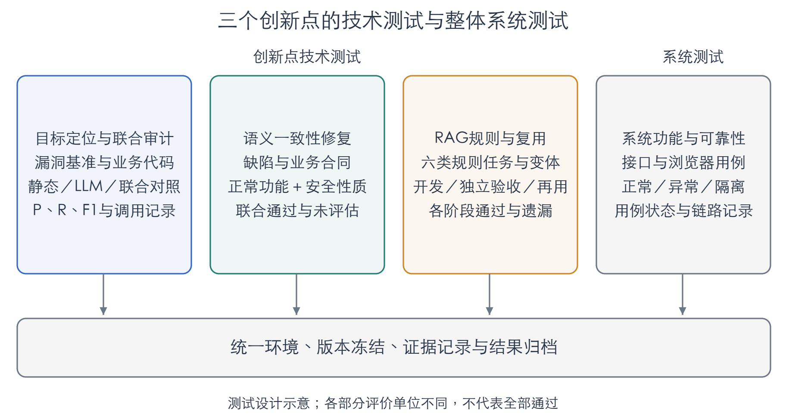
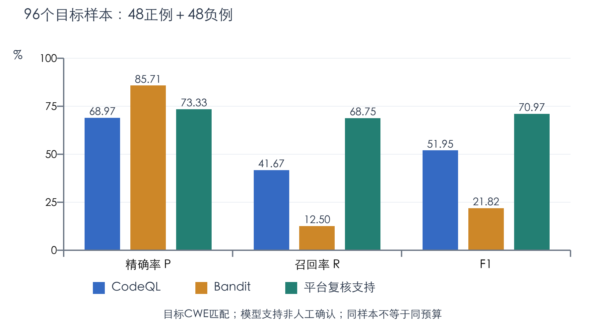
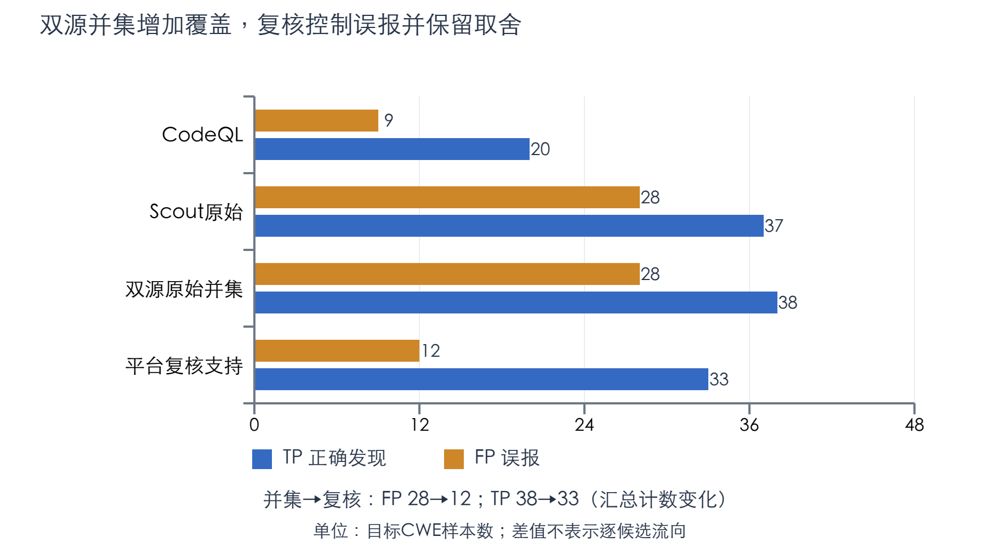
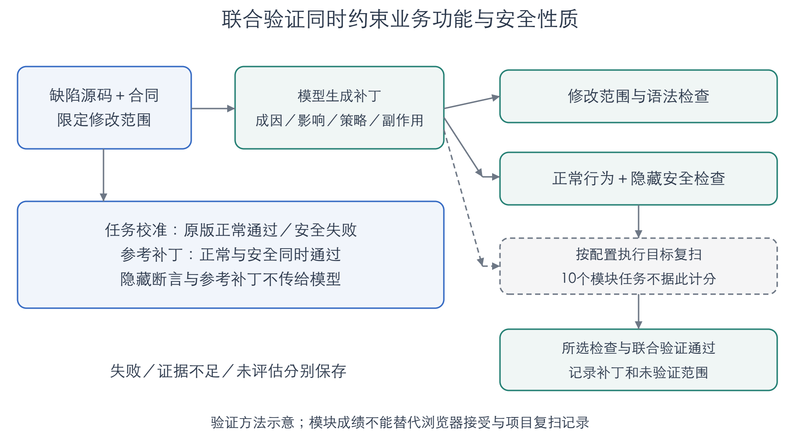
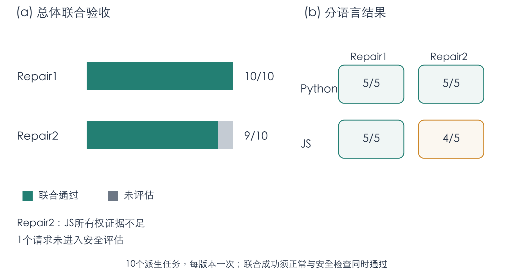
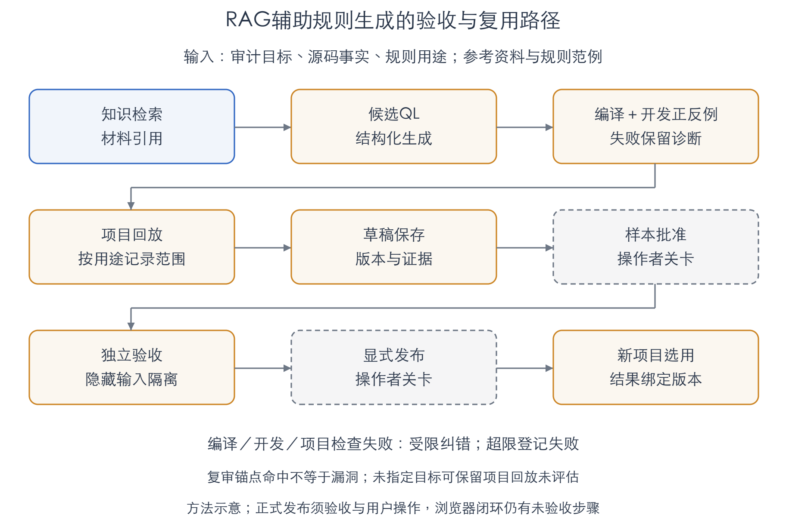
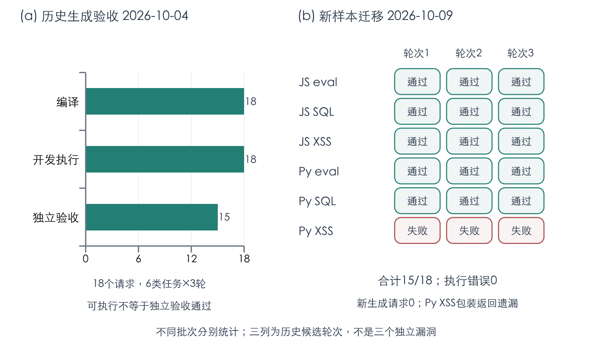
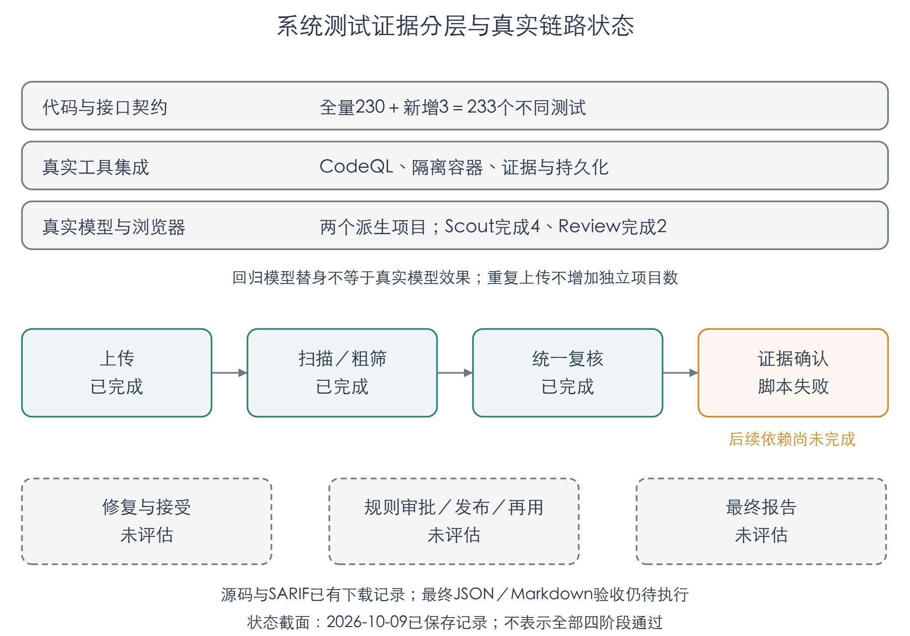

# 第三章 作品测试与分析

测试对象包括审计目标定位与联合审计、语义一致性智能修复、RAG辅助规则生成三个创新点，以及平台整体功能与可靠性。采用同样本工具对照、正常功能与安全性质联合验证、规则分阶段验收及真实浏览器操作四类方法，分别评价漏洞发现能力、修复后的功能与安全性、规则执行与迁移能力，以及模块间的衔接情况。

实验结果以截至2026年10月9日保存的记录为依据。发现与修复采用当前默认版本的新增样本；规则部分同时保留历史生成实验和冻结候选的新样本复测，两个批次分别统计。自动化回归与真实模型、真实浏览器测试也分别报告。已完成的有限验证支持相应能力分析，尚未执行或被前置步骤阻断的环节按未评估记录，不作为系统全流程通过的证据。

## 3.1 测试方案与环境配置

### 3.1.1 总体测试方案与评价方法

三个技术测试部分与作品创新点逐一对应。第一部分以漏洞基准代码为输入，比较CodeQL、独立LLM粗筛和联合审计的目标漏洞检出情况，评价精确率、召回率和复核前后的取舍。第二部分以已定位的缺陷和明确业务合同为输入，比较两个修复版本，要求正常行为与安全性质同时通过，防止通过删除业务功能获得表面上的安全改善。第三部分从规则生成到独立验收逐级检查，再用新控制与数据流样例复测冻结规则，评价查询可执行性、检测有效性及迁移边界。

系统测试采用代码与接口契约、真实工具集成和浏览器操作相结合的方式，检查任务状态、证据关联、用户隔离、功能入口及跨模块传递。图3-1给出各部分的测试对象与评价分工。四部分的计数单位分别为目标样本、修复任务、规则请求和功能用例，不能直接相加形成一个总体准确率。

发现测试采用两组新OWASP BenchmarkPython样本，合计96个；修复比较使用10个经校准的自建纯模块任务；规则测试包含六类任务各三轮的历史生成记录，以及18个冻结候选的新数据流复测；系统测试使用全量自动化回归和两个派生Web项目的真实浏览器链路。输入、版本、结果和日志按批次归档，失败尝试保留，不选择某次成功结果替代完整分母。

发现评价将正确命中目标文件与CWE的正例计为TP，错误支持目标负例计为FP，未支持目标正例计为FN，未支持目标负例计为TN。计算精确率P＝TP／(TP＋FP)、召回率R＝TP／(TP＋FN)、F1＝2PR／(P＋R)。修复成功要求正常功能和安全测试同时通过；规则分别统计编译、开发执行和独立验收；系统用例区分通过、失败、未评估。模型支持是自动研判结果，人工确认是独立状态，二者不混用。

### 3.1.2 测试环境与执行配置

2026年10月9日补测在ARM64架构的macOS 15.7.2主机上运行。平台后端、前端开发服务和任务执行器在本机运行，大模型推理通过远程服务调用；修复验证使用隔离容器。主要工具和依赖见表3-1。处理器具体型号和物理内存没有纳入冻结收据，绝对耗时不足以支持跨设备性能比较。

表3-1 2026年10月9日补测的主要执行环境

| 类别 | 版本或配置 | 用途 |
| --- | --- | --- |
| 主机环境 | macOS 15.7.2，ARM64 | 平台与评测任务运行 |
| 后端运行时 | Python 3.14.6，FastAPI 0.141.1 | API、任务管理和结果服务 |
| 工作流与任务 | LangGraph 1.2.12，Celery 5.6.3 | 阶段执行、恢复及异步调度 |
| 数据与检索 | SQLModel 0.0.39，Haystack 3.3.0，pgvector 0.5.0 | 状态持久化、词法和向量检索 |
| 前端 | React 19.3.0，Vite 8.3.2，TypeScript 6.0.3 | 工作台交互 |
| 静态工具 | CodeQL 2.23.5，Bandit 1.9.4 | 结构化扫描及同样本对照 |
| 隔离执行 | Docker 29.5.2；Python验证镜像、Node 22容器 | 正常功能和安全断言执行 |
| 浏览器 | Chrome 154.0.8037.98，Playwright 1.62.1 | 桌面与移动视口检查 |

表3-1记录2026年10月9日补测的执行环境。历史规则实验的环境以相应批次的模型、工具、输入和实现哈希收据为准。[R1—R3]

补测固定使用CodeQL默认code-scanning套件，Python查询包为1.6.0，JavaScript查询包为1.4.0；Python代码提取运行时为3.11.15。发现模块使用Scout7和Review9，修复模块的当前默认版本为Repair2，规则模块沿用Rule8。新增发现与修复测试的实际响应模型为deepseek-v4-1-flash-260910，测试期间未根据评分修改生产代码或Prompt。

发现、修复和系统链路采用不同预算。每个发现阶段上限为28次调用、500000 token和600秒；修复比较上限为12次调用、100000 token和240秒；真实Worker链路的进程阶段上限为20次调用、160000 token和480秒，适配器仍可施加更严格限制。上述上限用于限制执行，不代表实际消耗，也不能跨测试类型直接比较。历史规则主对照使用共同的6000输出token预算，其结果在规则节单独报告。[R1—R3]

### 3.1.3 系统部署与隔离条件

平台通过API接收上传项目并保存源码快照，异步任务执行静态扫描和模型阶段，数据库保存审计、候选、证据、决定与阶段历史。真实浏览器补测使用两个临时账号及独立Celery队列，避免消费已有用户的任务。浏览器访问真实前端、后端和数据库，并等待实际Worker执行完成，不以预先写入的完成状态替代真实扫描。

修复断言在无网络、只读挂载、非root和资源受限的Docker容器中执行，保存实际镜像ID和进程退出结果。正常行为与安全检查分别运行，评估端的隐藏断言和参考补丁不进入模型源码根。修复验证没有启动上传项目的目标HTTP服务，模块安全断言不等同于真实服务攻击利用回放。

## 3.2 审计目标定位与联合审计效果测试

### 3.2.1 测试目标与对照方案

目标定位与联合审计测试重点评价平台对目标漏洞的发现能力，以及静态候选、模型候选和复核证据如何共同影响结果。两组样本各48个，均含24个正例和24个负例，组间文件不重叠，并排除此前已经使用的200个文件。测试覆盖XPath注入、信任边界、安全Cookie、弱哈希、重定向、路径遍历、代码注入、反序列化、弱随机、XSS和LDAP注入11类情况。

为保留必要的框架上下文，每批输入包含公共辅助代码和模板等1308个文件，计分对象仍仅为该批48个目标样本。初始计划中的命令注入、SQL注入和XXE部分正负例池已不足，执行前收缩为11类，没有复用旧样本补齐。两批模型执行结束后才读取评分标签。新增样本的文件与既有测试不重叠，但同一公开项目的样本分布、结构筛查及标签隔离不能证明模型训练未见。[R1]

对照包括同源码CodeQL、Bandit、Scout原始结果、CodeQL与Scout的原始并集，以及Review后的平台支持结果。CodeQL每批实际扫描一次；Bandit每批运行三次，三次预测一致且原始JSON解析成功。两种静态工具使用同一批目标文件；平台在相同源码上进行独立粗筛与证据复核，因此能观察双源候选和复核的作用。

平台评价遵循精确文件与标签目标CWE匹配，不把其他CWE候选自动计入目标TP。未完成评估的候选保留未决状态，不默认排除。静态工具与模型阶段的预算、搜索方式和输出范围不同，对照结果反映相同样本上的检测效果，不能作为严格等预算的竞品效率比较。

### 3.2.2 漏洞检出与类型覆盖结果

表3-2与图3-2给出96个目标样本的合并结果。平台TP为33，较CodeQL的20多支持13个目标正例；FP为12，较CodeQL多3个目标误报。平台精确率为73.33%，召回率为68.75%，F1为70.97%。相对CodeQL，召回率和F1分别提高27.08和19.02个百分点，说明96个目标样本中补充发现带来的收益大于新增误报对综合指标的影响。Bandit精确率较高，但仅找回6个目标正例，其低召回不能由较高精确率抵消。

表3-2 相同96个目标样本上的性能对照

| 方法 | TP | FP | TN | FN | P | R | F1 |
| --- | --- | --- | --- | --- | --- | --- | --- |
| CodeQL | 20 | 9 | 39 | 28 | 68.97% | 41.67% | 51.95% |
| Bandit | 6 | 1 | 47 | 42 | 85.71% | 12.50% | 21.82% |
| Scout原始结果 | 37 | 28 | 20 | 11 | 56.92% | 77.08% | 65.49% |
| 双源原始并集 | 38 | 28 | 20 | 10 | 57.58% | 79.17% | 66.67% |
| 平台复核支持 | 33 | 12 | 36 | 15 | 73.33% | 68.75% | 70.97% |

分批观察，平台在第一组为TP17、FP5、TN19、FN7，F1为73.91%；第二组为TP16、FP7、TN17、FN8，F1为68.09%。合并指标由计数重新计算，不采用两组F1的简单平均。两组表现的差异表明，即使同属一个公开基准，样本组成仍会影响结论。结果不能推广为全语言、全框架或所有真实项目上的准确率。

### 3.2.3 定位工作量与复核结果分析

定位与取证的执行记录显示，两批目标案例的计划窗口均已检查，但安全属性调查仍分别保留127和131个unknown，合计258个。窗口被读取只能说明相应源码已进入检查过程，不能证明每项业务安全条件都被判定。候选层面另有1和2个未复核完毕的记录，不能以页面已完成或窗口覆盖完整替代证据充分性。

两批模型调度墙钟分别为597.47和521.71秒，调用数分别为126和115次，输入token分别为1088740和994546，输出分别为197160和175972。该记录反映分组调度下的实际工作量，不是用户从上传到最终报告的总时长；同时运行的修复及工具任务也影响资源条件。发现实验没有冻结“完全不做定位或上下文组织”的等预算对照，因此不能据这些耗时单独量化目标筛选带来的加速收益。

图3-3对比各阶段的目标TP和FP计数。双源原始并集达到TP38、FP28，召回率79.17%，但存在较多目标误报；复核支持结果变为TP33、FP12，精确率提高至73.33%，同时召回率降至68.75%。这表明复核能够改善96个目标样本结果的误报比例，也存在未保留部分真阳性的代价。汇总差值并不证明每条候选的逐项删除路径，因此不把它解释为16条误报和5条正确告警均已完成独立人工裁决。

模型还支持了68个不落入目标标签计分的告警，并保存88条其他CWE候选，二者不是互斥集合，不能相加作为156个新漏洞根因。全部告警的人工精确率仍未知。96个目标样本的结果显示，双源发现扩大候选覆盖，证据复核提高候选使用质量；进一步的跨框架泛化和逐根因人工评估仍需独立验证。

## 3.3 基于思维对齐的语义一致性智能修复测试

### 3.3.1 修复任务与对照方案

语义一致性智能修复测试要求补丁既处理已知缺陷，又保留正常接口和业务行为。测试构造Python、JavaScript各5个纯模块任务，覆盖HTML编码、SQL参数化、对象所有权、响应头换行、重定向和原型污染。Python任务包含SQL参数化，JavaScript任务包含原型污染，两个语言组不是完全相同的漏洞集合。

每个任务包含缺陷代码、可见业务合同、正常断言、安全断言和参考补丁。执行前进行校准，10个任务均满足原程序正常检查通过、安全检查失败，参考补丁两类检查同时通过。这样的准入确认了断言能够区分不安全原版和满足合同的参考实现；它不等于任务已得到独立人工金标准入。10个任务用于比较已知缺陷的修复效果，未覆盖自然项目从发现到人工确认的完整过程。[R1]

同一任务分别调用Repair1和Repair2各一次，交替执行顺序，共20个请求、10个独立任务。Repair1为旧版对照，Repair2为当前默认版本。模型接收业务合同及需要修改的代码，不接收评估端参考补丁和隐藏断言。生成后在相同隔离条件下独立执行正常与安全检查，失败请求保留，不根据隐藏结果追加补跑选择较好输出。

图3-4说明验证方法：限定修改范围后，对补丁进行正常行为和安全性质联合检查；实际平台项目链路还可按所选配置进行目标复扫。图中的项目复扫是系统验证路径，10个纯模块任务的联合成绩并不包含全部项目复扫或浏览器接受流程。固定结构的修复说明用于组织成因、影响、策略和副作用，最终是否有效仍由执行证据判断。

### 3.3.2 安全性质与语义一致性验证

安全断言针对具体风险验证。例如，HTML任务检查用户输入中的标签和特殊字符是否被编码；SQL任务在SQLite查询中检查恶意条件不能扩大返回集合；所有权任务要求跨所有者访问被拒绝；响应头任务要求CR或LF被拒绝；重定向任务拒绝协议相对路径和越界目标；原型污染任务拒绝危险属性路径并检查全局原型未被污染。判断依据是任务的可执行安全性质，而不是生成说明中声称已修复。

Repair1的10个请求均产生可评估结果并通过联合检查；Repair2有9个通过，剩余JavaScript所有权任务以关键业务／漏洞语义证据不足结束，没有补丁进入隐藏评估。该请求保留在分母中，登记为阶段失败、安全效果未评估，不能判为“已验证漏洞仍存在”，也不能以空补丁计作成功。

正常断言检查原有函数或导出接口、返回值和合法业务路径。例如，HTML编码仍应保留普通名称与中文字符；所有权检查仍应允许合法所有者读取；重定向仍应保留站内路径的查询串和片段；对象更新仍应保留无关字段。安全修复若删除业务操作、清空输入或改变关键返回语义，即使阻止了危险输入，也不满足联合成功条件。

修复验证主要覆盖接口与行为一致性，并没有独立的代码风格评分器。不能从正常断言通过进一步推出所有风格、性能和跨模块行为均保持不变。同样，隔离模块测试没有执行目标Web服务，模块验证结果不足以证明自然CVE利用已复现或线上兼容性已得到保证。

### 3.3.3 修复结果与典型案例分析

表3-3和图3-5报告两个版本的完整分母。Repair1联合通过率为100%，Repair2为90%；Python组均为5/5，JavaScript组分别为5/5和4/5。Repair2在10个任务中的联合通过率未高于Repair1，不能用版本更新顺序替代效果证据。

表3-3 两个修复版本的联合验收结果

| 版本 | 请求 | 阶段完成 | 联合通过 | 安全未评估 | Python | JavaScript |
| --- | --- | --- | --- | --- | --- | --- |
| Repair1 | 10 | 10 | 10/10 | 0 | 5/5 | 5/5 |
| Repair2 | 10 | 9 | 9/10 | 1 | 5/5 | 4/5 |

所有权任务的失败说明，修复阶段可能在证据准入处停止，而不是强行给出依据不足的补丁；但该停止也造成端到端任务未完成，必须计入成功率分母。10个派生任务的验证表明，多数模块补丁满足所列功能与安全条件，但尚不能证明思维对齐本身的独立因果增益，也不能据小规模自建任务推导自然漏洞修复率。

## 3.4 RAG规则生成与自进化闭环测试

### 3.4.1 规则任务与生成对照方案

规则生成与复用测试分别检查候选QL能否编译、能否符合正反例预期、能否通过独立样本，以及验证后的版本能否进入可控复用流程。历史生成主实验覆盖Python和JavaScript的eval、SQL和反射XSS六类任务，每类三轮，共18个请求。重复轮次用于观察生成稳定性，不等于18个独立漏洞任务。[R3]

2026年10月9日复测冻结历史full_v8臂的全部18个候选，不重新生成，也不挑选最佳候选。新数据包含12个源文件、12个正例sink和12个安全处理分支，用于检查helper调用、别名传播、格式化输入及局部遮蔽等变体。该组用途是历史漏洞检测器，不能直接替代当前默认复审锚点的验收；后者定位的是需调查的位置，命中不自动构成漏洞。[R1]

规则生成检索参考资料与可执行规则范例，并把相应材料与实际源码事实一起用于候选生成。历史主实验对照包含完整v8、仅BM25、提前检索、自由QL、移除范围上下文，以及复用的旧K结果。每组均以18个请求为分母，固定共同模型和主输出预算；旧K明确复用早期对照，未计入v8对照的新生成请求。

表3-4显示，完整v8的独立验收为15/18，与仅BM25、提前检索和旧K相同；自由QL为8/18，移除范围上下文为13/18。结果提示，受约束的生成空间和源码范围材料具有工程价值，但没有证据证明向量检索单独提高了六类任务的验收通过率。由于对照包含多个机制变化，不能把全部差异单独归因于RAG。

表3-4 历史v8规则生成对照与验收结果

| 方案 | 请求 | 编译 | 开发执行 | 独立验收 | 数据性质 |
| --- | --- | --- | --- | --- | --- |
| 完整v8 | 18 | 18 | 18 | 15/18 | 新生成 |
| 仅BM25 | 18 | 18 | 17 | 15/18 | 新生成 |
| 提前检索 | 18 | 18 | 17 | 15/18 | 新生成 |
| 自由QL | 18 | 10 | 8 | 8/18 | 新生成 |
| 移除范围上下文 | 18 | 17 | 14 | 13/18 | 新生成 |
| 旧K | 18 | 18 | 18 | 15/18 | 复用历史对照 |

### 3.4.2 规则编译与独立样本验证

编译检查验证查询符合相应QL语言和库接口；开发执行检查模型提供或任务定义的正反例是否在预期位置产生结果。full_v8的18个请求均通过编译和开发执行，但独立验收只有15个通过。因此，语法正确、库调用合法和开发样例通过，仍不足以证明规则已覆盖独立变体。

图3-6给出从检索、生成到发布复用的方法路径。编译、开发正反例和项目回放保留实际诊断，失败触发受限纠错；候选保存后，样本批准和独立验收是后续关卡，发布由用户显式执行。图中流程表示规则生命周期，不能作为2026年10月9日浏览器链路各步骤均已完成的证据。

历史独立验收在生成输入之外运行隐藏样本，测试结果不返回生成模型。2026年10月9日又用新控制与数据流探针复测18个冻结候选，每个查询通过真实CodeQL重新求值，避免动态查询缓存产生虚假的通过结果。新探针共有15个候选通过、3个失败、0个执行错误，详见表3-5与图3-7。

表3-5 冻结旧候选的新样本迁移结果

| 任务家族 | 历史候选 | 新探针通过 | 结果说明 |
| --- | --- | --- | --- |
| JavaScript eval | 3 | 3/3 | 迁移探针正反例通过 |
| JavaScript SQL | 3 | 3/3 | 迁移探针正反例通过 |
| JavaScript XSS | 3 | 3/3 | 迁移探针正反例通过 |
| Python eval | 3 | 3/3 | 迁移探针正反例通过 |
| Python SQL | 3 | 3/3 | 迁移探针正反例通过 |
| Python XSS | 3 | 0/3 | 遗漏包装HTML返回路径 |
| 合计 | 18 | 15/18 | 新生成请求为0 |

Python XSS的三个候选均遗漏两个包装返回正例，累计6次FN属于同一正例集被重复候选评估，不能称为6个独立漏洞。其他五个家族通过的是2026年10月9日迁移探针的验收条件，也不代表任意框架都有效。图3-7左右两部分来自不同日期与不同任务输入，两个15/18分别表示历史独立验收和新样本迁移，不合并为一次新生成成绩。

### 3.4.3 规则沉淀与复用闭环验证

规则沉淀的工程目标是保存经过相应用途验证的版本，使后续审计可以显式选用，并将扫描结果绑定到规则来源。项目回放用于检查候选与当前项目的关系，独立验收用于检查样例之外的行为，二者分别记录；没有指定新增发现目标时，回放可保留未评估范围，不能自动改写为新增漏洞成立。

代码和真实工具集成测试覆盖规则生命周期与相关验收门，但2026年10月9日的真实浏览器补测尚未完成样本批准、发布、再次上传选用及停用检查。历史生成与独立验收、冻结规则的新探针复测和浏览器复用闭环具有不同的执行记录与完成状态。规则文件已保存不能证明正式发布和实际复用已经完成。

### 3.4.4 测试结果与创新意义分析

规则实验的主要意义在于将模型生成内容交给真实工具和分阶段验收，而不是仅评价文本合理性。full_v8在有限六任务主实验中达到15/18独立通过，新迁移探针暴露了Python XSS包装返回的覆盖缺口，说明验收必须保留独立样本和反例；编译18/18不能推出检测有效性100%。

成本方面，历史完整v8的39次调用消耗278145输入token，提前检索同为15/18通过，但输入为399783 token，约高43.73%。仅BM25同样达到15/18，未显示向量检索的独立准确率优势。上述数据适用于该历史任务与预算，不是所有RAG场景的结论；生成可执行、正确检测和跨项目泛化应分别评价。

## 3.5 系统功能与运行可靠性测试

### 3.5.1 功能回归与界面测试

系统测试以现有工作台和四阶段审计操作为对象，分为自动化回归、真实工具集成、合成状态界面验证，以及真实上传／Worker／模型链路四类。自动化回归便于稳定检验失败状态、任务隔离、证据绑定和验收契约；合成状态界面验证检查显示和交互；真实链路则检验上传产物能否实际进入扫描与模型阶段。各类证据之间不能互相替代。

启用真实工具集成的全量回归共230项，0失败、0错误、0跳过。后续17项评测与归档检查中14项与全量测试重叠，新增3项，累计233个不同测试通过。许多回归中的模型为可控替身，因此233项通过反映代码及工具契约，不是233个真实模型漏洞案例。[R2]

有效界面检查通过真实Chrome、API和数据库执行，覆盖登录、任务列表、扫描失败与空结果显示、阶段导航、无确认的修复入口、文件类型和语言控制、移动视口、退出及控制台健康。该批使用合成终态任务，结果为10/11通过；其目的是验证页面状态与交互，不代表真实模型生成已经完成。表3-6概述功能结果。[R1]

表3-6 核心界面与状态显示检查

| 功能或状态 | 结果 | 验证含义 |
| --- | --- | --- |
| 登录与受保护路由 | 通过 | 身份入口和页面保护有效 |
| 扫描失败显示 | 通过 | 失败不伪装为成功零结果 |
| 完成且无告警 | 通过 | 保留不代表代码安全的说明 |
| 阶段导航与修复确认门 | 通过 | 页面切换及前置条件可见 |
| 文件类型与语言选择 | 通过 | 非法格式拒绝、选择状态更新 |
| 移动视口整体溢出 | 通过 | 页面整体未超390像素宽度 |
| 移动退出入口 | 失败 | 窄屏样式隐藏了退出按钮 |
| 桌面退出与控制台健康 | 通过 | 会话清除，最终错误集合为空 |

表3-6按功能归类，八行不是原始11个断言的分母。桌面视口为1440×1000，移动视口为390×844。移动页面仍有局部表格横向滚动；整体未溢出不能推出所有小屏操作均可完成，移动退出入口的失败需要单独整改。

### 3.5.2 系统集成与安全隔离测试

真实链路使用Python/Flask和JavaScript/Express两个派生项目，项目的calc模块接受整数字符串，原版eval能够执行合同之外的表达式。两个项目各上传两次，共4次实际扫描和4个完成的Scout阶段；两个Review9阶段完成。两语言均有源码与真实SARIF下载记录，并验证未确认候选直接发起修复会被拒绝。重复上传用于保留尝试和恢复检查，不按4个独立项目统计。

后续步骤没有完成全部验收。第一次页面证据读取返回code类型，测试脚本错误地期待source，导致两个确认步骤失败；修正后第二次尝试的同名历史任务造成严格定位歧义，未能继续页面操作。这些是测试脚本错误，不能列作扫描或模型质量失败。依赖确认的真实修复、规则生成审批与发布再用、最终报告导出仍未评估。图3-8明确列出已完成、脚本失败和未评估范围。[R2]

两项目另已完成修复测试校准：原版正常功能通过、安全检查失败，参考补丁联合通过。但参考补丁不是模型生成补丁，校准通过不能替代真实Repair2、项目回归、CodeQL重扫和浏览器接受的完成记录。当前证据支持上传、扫描、粗筛、复核及部分下载链路已运行，不支持全部四阶段浏览器操作已通过。

既有自动化及真实工具测试重点覆盖任务隔离、失败状态、实际证据绑定、动态查询重新求值和规则正反例。真实浏览器也验证了未确认候选的修复拒绝，两个项目均返回HTTP 409；合成状态界面验证了工具失败不显示成功零结果。不同类型的检查共同约束“未执行不得记为成功、缺少证据不得直接确认”的处理原则。

2026年10月9日补测中，第二账号访问源码／审计／规则／报告的浏览器检查、规则停用，以及最终共享语料复验仍未执行。临时测试服务已停止，测试账号与阶段记录保留以便恢复。失败尝试、输入及执行版本保留在不可覆盖归档中，原始源码快照不因测试脚本修订而重写。

### 3.5.3 运行消耗与测试结果分析

2026年10月9日新样本补测产生68个模型阶段、272次调用，输入2129581 token、输出385875 token；随后真实链路产生6个阶段、22次调用，输入129065、输出24016 token。合计294次调用，输入2258646、输出409891 token，实际响应模型均为deepseek-v4-1-flash-260910。调用按唯一阶段和实际收据统计，重复保存或恢复不重复计数。

上述调用是发现、修复和链路验证等混合负载，不能除以某一个任务数作为统一单任务成本。账单金额尚未取得，不推算货币费用；并发、缓存和测试调度影响耗时，不将其作为公平竞品延迟排名。历史规则调用与token另在3.4节说明，未计入2026年10月9日新增模型调用。

系统结果表明，平台的代码、工具及状态处理已具备较完整的自动化检查，真实上传、双引擎扫描和复核也有实际执行证据；同时，移动退出入口存在可见问题，浏览器确认后的修复、规则发布复用和最终报告仍需完成验收。完整记录这些差异有助于区分算法效果、工程可靠性与用户流程的不同成熟度。

综合三个技术测试，平台在96个目标样本上提高了目标召回与F1，修复在多数派生任务上保持正常功能并满足安全断言，规则的真实编译与独立验收能够发现样例之外的缺口。应用价值主要体现为将候选、证据、补丁、规则及验证状态组织为可审阅的审计辅助过程。下一步需要补齐真实浏览器闭环、独立人工告警裁决、自然项目修复准入及新框架规则验证，再评价更广泛场景下的效果。

实验记录来源

[R1] 2026年10月9日默认能力补充测试及机器汇总：supplemental-20261009-results.md、supplemental-20261009-summary.json。发现、修复、冻结规则新探针及有效GUI检查分别保存原始收据。

[R2] 2026年10月9日真实Worker／浏览器链路补测及机器汇总：chain-completion-20261009-results.md、chain-completion-20261009-summary.json。全量回归、实际上传与阶段、失败尝试和恢复边界分列。

[R3] 2026年10月4日RAG规则稳定化阶段结果及机器汇总：rag-stabilization-results.md、rag-stabilization-summary.json。历史新生成请求、复用对照和独立验收分别计数。

[R4] 测试结果与内容版本登记册：20261009-workspace-v3。冻结509个源码／测试／配置文件、47份报告及1184份本地结果收据；归档校验通过表示保存一致，不等于所有测试均通过。
