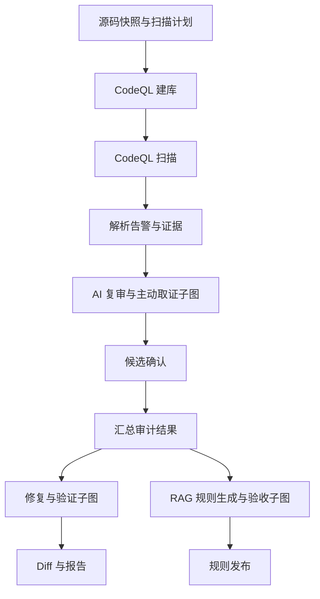

# 技术栈与模块边界

## 技术选择

| 部分 | 选择 | 职责 |
|---|---|---|
| 基础模板 | 官方 Full Stack FastAPI Template | 前后端、数据库及部署基础（账号功能已移除） |
| GUI | React、TypeScript、Vite、shadcn/ui | 四阶段审计工作台 |
| API / 数据校验 | FastAPI、Pydantic | 请求响应校验；与流程编排职责分离 |
| 数据与迁移 | PostgreSQL、SQLModel、Alembic | 业务记录、事务、版本化迁移 |
| 全流程编排 | LangGraph | 主图、子图、检查点、人工暂停与恢复 |
| 图状态 | TypedDict | 清晰的状态契约；运行时仍需校验外部输入 |
| 后台调度 | Celery、Redis | 投递与执行图任务，不另建重复的流水线逻辑 |
| RAG | Haystack、pgvector | 文档处理、检索与重排 |
| 静态分析 | CodeQL CLI、query packs | 抽取、扫描、查询测试 |
| 产物 | 任务级本地目录、ArtifactStore 接口 | 隔离保存快照、SARIF、数据库、日志、补丁 |
| 验证 / 部署 | pytest、API/CLI 集成测试、Docker Compose | 行为测试、本地部署与执行环境分离 |

初始化时锁定模板提交与依赖版本。四阶段依赖已经锁定。Haystack BM25 使用持久化知识块，pgvector 混合检索按配置启用；中文检索采用汉字与标识符分词。每次检索最多处理最近 1000 个可见块，当前没有独立重排器。

## LangGraph 主流程



运行图需实现失败、重试、跳过、人工确认和有限次数反馈循环。上图是阶段关系，不表示所有阶段必须执行。

图节点调用用例或适配器，不包含完整扫描命令处理或大段 Prompt。图状态主要保存 ID、状态和摘要；大文件放在产物存储。

检查点不保证外部命令只执行一次。领取任务通过数据库条件更新抑制重复投递；失败重试创建新的执行 ID，外部调用仍不保证恰好一次。人工等待时释放 Worker；恢复任务重新投递。

## 模块与依赖

```text
backend/app/
  api/             # HTTP 路由
  contracts/       # 数据契约
  domain/          # 纯业务约束
  services/        # 四阶段业务用例
  workflows/       # 主图、子图、节点与状态
  ports/           # 可替换的外部边界
  adapters/        # CodeQL、模型、检索、执行器、产物
  persistence/     # ORM、仓储与事务
  jobs/            # 后台任务入口
  core/            # 配置、日志与装配
frontend/src/
  features/        # 上传、任务与四阶段
  components/      # 通用展示组件
  api/             # API 客户端
```

API/jobs → workflows/services → domain/ports。adapters/persistence 提供实现，初始化模块完成装配。domain 不依赖 Web、任务或 AI 框架。

本项目为单工作区本地 Web 工具，无登录、注册、用户管理或令牌校验。为保留现有任务/规则/知识外键，内部工作区复用历史管理员归属 ID；新安装创建固定且不可登录的内部归属记录，API 不暴露账号接口。`FIRST_SUPERUSER` 仅为兼容旧数据的可选归属选择，管理员密码与 JWT 密钥不再是启动必填项。

任务、阶段执行、证据、发现、判断、修复尝试、规则版本与知识版本分别持久化。规则 ID 不能代替漏洞实例身份。

API 处理短请求，后台运行图。分析构建环境不获得模型或数据库凭据；每次执行拥有独立工作区与资源限制。CodeQL 当前仍在主机运行，仅用于可信本地代码；修复验证在无网络、只读挂载、非 root 的 Docker 容器中运行。

## 官方参考

- https://github.com/fastapi/full-stack-fastapi-template
- https://docs.langchain.com/oss/python/langgraph/overview
- https://docs.celeryq.dev/en/stable/userguide/tasks.html
- https://docs.haystack.deepset.ai/docs/retrievers
- https://github.com/pgvector/pgvector
- https://docs.github.com/en/code-security/concepts/code-scanning/codeql/codeql-cli
