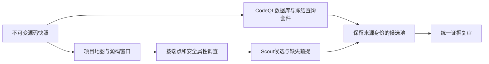

# 静态分析与语义审计的互补发现：机制与收益来源（2026-11-02）

版本：2026-11-02。本文解释项目现有发现链路，以10-14冻结日志和11-02离线核对为证据；不将后续本地代码改进倒推成历史成绩的原因。

## 1. 这一机制实际解决什么问题

单一发现器只能发现其输入范围和表达能力覆盖的安全条件。静态规则通常从已建模的操作、数据流或API模式出发；Scout从源码窗口、端点和待检查安全属性提出假设。两种观察方式产生不同的遗漏集合，因此合流有机会提高召回。

这种互补是**错误模式和观察范围的互补**。它不保证每个Scout独有输出都更复杂、更正确，也不保证静态没有输出就是“规则写不出来”。真正需要证明的是：在排除范围和计分差异后，Scout是否找到了静态基线遗漏、并由独立证据成立的安全条件。

## 2. 生产实现如何形成两种观察方式

入口见[双分支工作流](../../system/backend/app/workflows/dual_scanning.py)。CodeQL分支和独立Scout分支从同一审计快照启动，汇合时保留各自状态，未完成、失败和无告警分别记录。

[ScoutService](../../system/backend/app/services/scouting.py)的初始请求包括实际源码页、项目地图、分配任务和导航线索，独立发现请求不以CodeQL告警作为前提。模型可以请求源码读取、搜索和调用线索；源码位置必须落在实际取得的证据中。

[scout_inspection.py](../../system/backend/app/services/scout_inspection.py)维护待检查任务、调查回执、窗口范围和调用分配。[scout.v7](../../system/backend/app/prompts/scout.v7.txt)要求分别检查身份认证、角色授权、对象归属、输入传播、输出编码等安全条件，避免只搜索熟悉的危险函数名。

这些机制增加了“注意到某类问题”的机会，但任务被调查不等于安全条件已证明。`investigated`是调查覆盖声明；实际成立还需要后续证据复审。语法路由和词法调用线索也不是完整可达调用图。

10-14实验使用Scout v7。当前代码的后续版本能力应单独说明，例如仅在v8等特定版本启用的静态值线索，不能用于解释v7历史收益。

## 3. 静态基线的优势与盲区来自哪里

CodeQL把源码抽取为数据库，查询在已定义的程序表示和库模型上寻找满足条件的路径。已建模的输入、危险操作和防护有明确语义，输出可追溯、重复运行稳定；其优势尤其适合重复出现、可形式化的模式。

但“工具支持Python”并不等于默认suite覆盖所有Python漏洞。能否命中至少取决于：目标文件是否抽取成功；相关库/API是否建模；运行的具体查询是否包含该条件；路径和过滤条件是否满足；最终位置与CWE是否被评测器接受。

因此，一条未命中可能来自规则范围、模型精度、抽取范围、合法过滤或评分分类。把它们全部归为静态工具的语义理解失败，会夸大系统的新增能力。

本次静态身份是CodeQL 2.23.5、python-queries 1.6.0、默认code-scanning套件。更换为其他suite属于新的诊断对照，不能覆盖原基线。

## 4. Scout为什么可能补充发现

第一，调查目标更宽。对同一处理函数，模型可以分别提出注入、未编码输出、越权和不安全配置条件；这允许发现没有对应现成规则或未在所用suite中启用的条件。

第二，模型能结合局部语境组织假设。例如对“从请求路径选择目标用户”和“从令牌主体选择目标用户”的分支差异，可以提出对象归属问题；对字符串先拼入模板源码、再编译模板的顺序，可以提出模板注入，而不是仅看见一个模板函数名。

第三，关联源码可改变判断对象。读取入口、处理函数、模板、守卫和配置后，单行操作可以被放回局部控制链。这里的优势依赖相关页确实进入请求，也依赖模型正确使用；导航列表中存在文件名并不提供这些事实。

第四，模型已有的API和框架知识能帮助选择取证位置。但知识只是解释与导航的先验，不能替代项目实际源码、绑定和版本证据。README或训练场景提示也可能抬高“代码有漏洞”的先验；没有去提示对照时，不能排除这一影响。

## 5. 独立命中集合给出的直接证据

以676个漏洞金标为分母，冻结官方匹配器下的独立命中关系是：

| 独立命中类别 | 金标数 |
| --- | ---: |
| CodeQL与Scout都命中 | 80 |
| 仅CodeQL命中 | 26 |
| 仅Scout命中 | 309 |
| 双方均未命中 | 261 |

CodeQL共106，Scout共389，直接独立集合并集为415。正式合流C计416：其中1个金标在独立两组中未被分配、在合流后获得分配。这是贪心、一金标一次使用和候选兼容关系导致的分配差异，不能将它解释为合流阶段新读源码发现了一个根因。

表明互补的最直接事实是存在两边各自独有命中。26个静态独有命中也说明Scout不能完全替代静态分支。

## 6. 309个Scout独有命中还要怎样拆解

离线脚本[audit_mechanism_cohort.py](../../benchmarks/experiments/audit_mechanism_cohort.py)保留官方文件、替代位置和±10行规则，仅放宽CWE后得到：

| 可观察信号 | 数量 | 解释边界 |
| --- | ---: | --- |
| 附近存在其他CWE的静态输出 | 34 | 可能是分类差异，也可能是邻近不同缺陷；需实际根因核对 |
| 附近没有静态输出 | 275 | 尚不能区分规则、抽取范围、过滤和语义推理 |

这不是34个确定的“评分假增益”和275个确定的“语义真增益”。位置邻近并不证明同一根因，缺少输出也不证明缺少规则。

后续归因应按四轴分别登记，允许多因：

| 归因轴 | 必要核查 | 可接受的结论形式 |
| --- | --- | --- |
| 规则覆盖 | 实际query清单、目标条件与查询语义 | 所运行suite没有对应规则，或规则虽相关但该路径不满足 |
| 语义理解 | 同一可见输入下的可控值、操作、保护、授权要求 | 有证据支持的语义补充；或推理仍未成立 |
| 输入范围 | 文件抽取、过滤、语言、失败回执、实际模型页 | 发现范围不同；或输入相同且范围混杂已排除 |
| 评分分类 | CWE、主位置、替代位置、重复与分配关系 | 分类/分配收益，与新增根因数分开 |

## 7. 最终系统优势有多少由发现阶段贡献

最终F相对独立CodeQL保留102个命中，增加252个，丢失4个。252个增加中250个已经被独立Scout命中。因此，现有证据更支持“新增覆盖主要来自Scout发现，然后由Review筛选保留”，而不是“Review大规模创造新发现”。

F相对A召回从15.68%到52.37%，但未匹配输出也从297增加到366。系统提高了覆盖，并未在相对静态基线的所有误报指标上同时改善。

增加命中的主CWE中，XSS为50、硬编码凭据为45，占252个中的37.70%；SQL注入17、对象归属13。这个分布说明优势同时包含常见输出/配置条件和部分跨路径权限问题，不能全部包装为复杂业务逻辑理解。

项目层面PyGoat增加30、VulPy增加22、DSVPWA增加18个相对CodeQL命中；也有项目低于保存的外部LLM结果。应保留优势项目与反例，不能只挑选有利样本推断整体领先。

## 8. 可以解释的收益链与尚未证明的原因

观察到的收益链是：不同调查目标和推理先验产生更多候选，相关源码支撑其中一部分，统一复审保留部分新增覆盖，最终召回提高。

其中，候选/金标转移和输入日志是已观察事实；“任务分解比通用提示更有效”“语义理解比增加token更重要”“同预算优于扩大静态suite”仍是待检验因果假设。现有六组没有分别开关这些内部机制，也不是同预算、未暴露项目上的多次重复实验。

还必须研究Scout未匹配候选，而非只研究309个已命中金标。官方未匹配FP可能是真误报、重复、CWE或位置差异、金标不完整；未人工裁决的保持未知。

## 9. 如何把优势来源验证成机制结论

固定源码、提取范围、模型、候选身份与预算，分别对比：默认suite与规则扩展；属性任务调度与相同预算的普通窗口阅读；无关联页与有针对性的关联页；固定原CWE/位置的评分与允许重新分类的评分。

由盲化引擎来源的独立裁决者核实真实成立条件，记录主因、次因和分歧。指标同时给出官方金标命中、去重复根因、人工确认补充发现、未匹配候选的真实性和每个正确新增根因成本。

只有在这些控制下仍有稳定增加，才能把增益归因到具体机制。当前适合的研究表述是“源码属性调查与规则分析的互补发现及其来源分析”；尚不能只凭TP高就证明学术新颖性或泛化优势。

## 10. 参考日志与复现入口

- [正式汇总](../../artifacts/research/realvuln/20261014-ablation/formal-summary.json)、[独立发现关系](../../artifacts/research/realvuln/20261014-ablation/discovery-overlap.csv)。
- [309个待归因案例](../../artifacts/research/verification/20261102-audit-mechanisms/complementarity-cases.csv)、[总体诊断汇总](../../artifacts/research/verification/20261102-audit-mechanisms/cohort-summary.json)。
- [252个增加命中明细](../../artifacts/research/verification/20261102-realvuln/advantages/added-gold-cases.csv)、[项目比较](../../artifacts/research/verification/20261102-realvuln/advantages/project-advantages.csv)。
- [完整实验协议](../../benchmarks/experiments/audit-mechanisms-protocol-20261102.md)。以上是历史结果重算与机制分析，不是11-02新增RealVuln模型实验。
