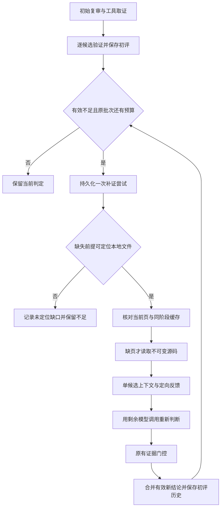

# 发现与复审之间的反馈补证：DVGA缺口、修复与效果机制

版本：2026-11-02。本文区分10-14历史实现、11-02本地修复和待运行的模型效果实验。服务器未由本轮更新，同学可以继续在原服务器版本开展测试。

## 1. 补证改变的是什么

一次未决判断可能有两种原因：现有证据无法回答必要前提，或证据已经存在但没有进入当前请求/没有被正确利用。前者需要获取新的相关事实，后者需要重新组织和核对已有事实。

补证的目的，是让下一次判断基于更充分、更相关、来源清楚的证据。它不保证把未决变成支持：有效保护可能使其被排除，业务政策仍缺失时可能继续未决。正确性与未决减少必须一起衡量。

## 2. DVGA原始日志真正证明了什么

正式F阶段`665eefc4-2632-4695-9351-46993b5551b5`的批次`407adb0642472ce21737b9ea`包含一个JWT候选和users/audits/delete_all_pastes三个认证候选。

| 原调用 | 证据或行为 |
| --- | --- |
| 17 | 另批已经提供`core/middleware.py`1–126行 |
| 23/24/28 | 另批已经提供`core/view_override.py`完整两页 |
| 29 | 当前批读取`core/views.py`1–151行 |
| 30 | 读取`core/helpers.py`1–41行 |
| 31 | JWT候选支持；其余三个不足，明确提出中间件/封装层与业务策略缺失 |

第31次请求中没有上述中间件、视图封装正文。`remaining_model_calls_in_batch=6`包括当前调用，`finalize_required=false`；也就是还有最多5个后续本地调用位置，但模型选择final，宿主直接保存并退出。

所以本例证明：**阶段内已有相关证据未被带到这个目标，且有效未决未触发继续补证。** 它不证明模型已经看见这些正文却故意忽略，也不证明只补这两份文件就满足所有漏洞成立条件。

完整冻结目录仍缺失，保存的`core/views.py`仅覆盖1–500行、501–525行未恢复。相关挂载代码和真实业务政策如果仍缺，就必须继续记为缺口。

## 3. 原项目有循环，为什么仍会断在这里

原实现有模型提出工具、执行读取、再次调用模型的循环，也有源码预读、分页和有效引用校验。它并非完全没有补证能力。

缺的是有效`insufficient`后的宿主调度。[原失效分析](../../benchmarks/reports/audit-mechanisms-diagnosis-20261102.md)指出：模型返回final后，`save_batch`接收结论即返回；未评估恢复将所有有效recommendations都当作reviewed，所以不足者也被排除在恢复队列外。

初始上下文又按当前候选重建，未把全阶段已有证据检索成当前缺失前提的答案。后续新读到imports，只刷新已知窗口与已登记控制缺页，也不等于重新规划了整个保护链。

另一个通用问题是第一次重复读取就触发下一轮final-only，即使剩余预算允许读取一个新的文件。本例未由此触发，但它会压缩合法的后续取证机会，本轮一并修复。

## 4. 必须分开的四个证据层次

| 层次 | 证据在哪里 | 不能自动推断什么 |
| --- | --- | --- |
| 库中已有 | 当前阶段Evidence记录保存了页和digest | 该页已发送给当前模型请求 |
| 请求可见 | 实际payload包含该证据ID和正文 | 模型正确使用了它 |
| 被结论引用 | 前提/说明中引用相应页与quote | quote能证明整条推导 |
| 支持前提 | 事实与目标属性、路径和业务义务关系成立 | 其他未读本地控制也已被排除 |

新实现与诊断均保留这些区别。尤其不能把“同文件完整提供”直接计成已解决一个业务前提。

## 5. 本轮修复后的状态流

循环中的再次选择只处理尚未尝试的不足候选，每个候选最多一轮。已支持、已排除的同批其他候选不会因此被重新评估。

## 6. 代码职责与持久化边界

| 模块 | 职责 |
| --- | --- |
| [review_batch.py](../../system/backend/app/services/review_batch.py) | 执行原批次有限模型/工具循环，调度补证，区分可恢复失败与完整性/取消 |
| [review_feedback.py](../../system/backend/app/services/review_feedback.py) | 冻结策略和提示，预留一次尝试，构造缺失前提反馈与受限上下文 |
| [review_evidence.py](../../system/backend/app/adapters/review_evidence.py) | 解析缺失项中的文件线索，验证同阶段缓存，读取未覆盖窗口 |
| [review_batch_history.py](../../system/backend/app/services/review_batch_history.py) | 在同一逻辑批次合并有效复评，保留初评和逐次历史 |
| [review-feedback.v1](../../system/backend/app/prompts/review-feedback.v1.txt) | 版本化反馈要求，不允许用文件可见性替代前提成立 |

`UnifiedReview`仍只组织阶段准备、批次调度和最终保存。新增功能不另起后台任务，不要求新的模型服务或框架。

阶段结果保存`review_feedback_policy`和`review_feedback_attempts`；批次保存最新有效`assessments`、`revision`、`assessment_history`和`call_reference`。每次原始请求/响应仍保存于`batches/<id>/call-N/`，尝试收据保存在`feedback/<attempt-id>/attempt.json`。

因此，“最后显示的判断”与“曾经如何判断、为何变化”都能追溯。一次复评漏答、引用错误或provider失败，不会把已经通过校验的初评抹掉。

## 7. 已有证据如何被安全复用

缓存查询限定相同审计、相同阶段、相同snapshot和code类型。每个命中再检查内容digest、引用范围及实际冻结文件中对应行的内容；不跨任务、跨阶段借用相似文本。

当前请求已完整覆盖的页不重复添加；缓存能填的缺口优先使用缓存原ID。剩余缺页通过原`EvidenceService`读取并持久化，一页至多151行，仍受文件大小、路径范围和正文限制。

同阶段复用减少重复源文件读取，并确保“此前已经知道的相关事实”能够进入当前请求。但它不会自动减少模型输入token：同一页若发送给多个单候选请求，仍会产生实际请求成本，需单独统计。

## 8. 为什么使用单候选复评

DVGA原始上下文31702字符，直接补入三页会到42434，超过40000上限。简单把“所有证据塞回去”并不可行。

本轮按单个不足目标构造复评，保留初次证据正文和目标来源，只压缩导航信息；每页加入前重新检查上下文预算，不能截断证据来假装完整。未装入请求的页明确记录`context_budget`，不会出现在可引用证据集合中。

原批次中的其他候选保持原有效结果。已有复评只可修订之前不足且身份相符的目标，不能借补证改写一个已经支持的兄弟候选，也不接受补证过程额外生成的新发现。

## 9. 预算如何共享，而不是重新获得额度

新入口参数`ReviewRequest.supplement_insufficient`默认true，可设false作消融。初次准备时把开关、版本、提示正文/digest及最多3页的自动供给上限冻结到阶段结果。

模型复评使用**原批次剩余step位置**，不另给一套`max_steps`；provider原有calls/tokens/seconds预算继续生效，重试也受provider预算约束。每候选一次尝试在取证或模型请求前写入，恢复不会刷新次数。

自动供给上限3页是每次宿主补证的上限；模型在剩余step内仍可请求新的合法事实。总体受原批次步数、上下文和配置的阶段预算共同约束。

必须注意：历史progress模式的全阶段`max_calls/max_tokens/max_seconds=0`表示没有相应阶段总限额。本轮沿用预算，不会把0偷偷改成硬上限；这种配置下只能声称局部循环和页数有界，不能声称总token成本有严格金额上限。正式预算实验应使用CLI冻结的非零限额。

已准备过的旧阶段不会在恢复时自动启用新策略，历史已完成批次也不会被自动重跑。新参数只使新运行可显式控制该机制，不能用于把旧实验改写成新版结果。

## 10. 停止状态本身也是实验结果

| 情况 | 当前行为与含义 |
| --- | --- |
| 补齐事实且门控接受 | 保存支持、排除或仍不足，保留前一版历史 |
| 只缺业务政策且无本地文件线索 | `no_local_source_target`，保留未决，不臆造要求 |
| 路径不可读、范围外、没有可用页 | 记录来源事件与`no_source_progress`，不猜测保护 |
| 上下文/页数不足 | 记录预算缺口，已有正文不截断，初评保留 |
| 复评引用错误或漏答 | 拒收新评估，原有效不足仍在 |
| provider或剩余步数耗尽 | 尝试为incomplete，保留原结论；全阶段预算/服务错误按原调度停止 |
| 取消、跨身份、快照或缓存损坏 | 明确传播取消/完整性错误，不能伪装普通不足或空成功 |

V1自动定位依赖缺失前提中明确的本地文件线索。只有函数名、模糊政策或尚未找到挂载位置时，不保证自动规划出检索路径；后续可增加结构化取证目标与搜索规划，但需作为单独版本验证。

## 11. 历史频率支持什么判断

F组26项目有22个存在不足，共264个，说明可研究的未决对象跨项目存在。它并不证明264个都是错误弃权。104个不足所在批次做过读取，也不能证明那些读取服务于该候选。

保存请求的三个所选项目中有33个有效不足事件，8个涉及更早请求已有、当前未提供的页；32个在非强制final且还有后续调用位置时结束。这个分布支持继续检查证据供给和停止策略，但样本经选择，不能外推全量错误率。

其中4个事件提及当前完整文件，仅表示值得核对；文件里未必包含所需事实，不能把它们直接记为“忽略已存在证据”的确认错误。

## 12. 本地回归验证了什么

最新工程测试见[feedback-regression.xml](../../artifacts/research/verification/20261102-audit-mechanisms/feedback-regression.xml)与[test_review_feedback.py](../../system/tests/test_review_feedback.py)。使用一次性本地PostgreSQL、真实Evidence/Candidate/StageRun持久化和显式模型替身，未调用外部模型。

最终同批回归85项通过，其中21项为补证专项，另64项覆盖原有复审、前提、展示、上下文、CLI与共享运行时；0失败、0错误。统一收据与当前代码摘要见[修复验证汇总](../../artifacts/research/verification/20261102-audit-mechanisms/feedback-fix-validation.json)。

提交前又将暂存内容导出到独立源码快照，排除工作区其他OpenHands/CLI改动，73项审计相关回归与14项离线诊断测试通过。原85项中的12项CLI/共享运行时测试属于此前工作区能力，本次审计修复提交不纳入那些独立改造。独立回归收据见[commit-regression.xml](../../artifacts/research/verification/20261102-audit-mechanisms/commit-regression.xml)。

覆盖：已有页的原ID复用；未缓存页真实读取；三个不足候选在共享预算内逐项复评；同批已支持候选不变；实际常量返回保护可触发排除；仍缺事实继续不足；无效复评/provider中断保留初评；恢复不加次数；全局调用额度；上下文不截断；跨阶段缓存隔离；缓存损坏；取消；旧阶段兼容；重复读取后仍可读取新事实。

这些回归证明了调度、来源、状态和预算的工程性质。模型替身的正确回答由测试设定，因此它们**不能证明真实模型理解变好，也不能证明dvga-021已找回**。新RealVuln模型成绩尚未产生。

## 13. 优势可能如何产生，代价又在哪里

补证最可能改善的是“事实在本地可得，但首轮未提供”的候选。重新组织已有页降低信息遗漏，单候选反馈让模型聚焦缺失前提，新读取补齐保护/路径事实，从而有机会把不必要的弃权转成正确决定。

若缺少真实业务要求、动态控制无法解析或模型即使看到页仍推理错误，收益会下降。更多页也可能增加噪声与token消耗；更多判断增加错误强行定性的机会；只看未决率下降可能奖励这些错误。

因此完整指标应记录未决→正确支持、正确排除、仍未决、错误决定的转移；真实根因保留、前提正确率、已有页供给率/使用率、每次正确解决成本与停止原因。

## 14. 下一步因果对照

已准备的[DVGA四组保存上下文输入](../../artifacts/research/verification/20261102-audit-mechanisms/dvga-replay/preflight.json)分别开关缺失前提提示和已有页供给，用来区分重新核对与增加证据的作用；目前未执行。

新版真实工具循环还应与同预算重复判断、非定向补读及关闭补证比较。固定候选、模型、初始证据和分类策略，记录实际provider请求与token，未定位政策保持未知；再在预留项目重复。

当前可以说：DVGA揭示的有效未决不再触发补证的问题已在本地修复并有工程回归。尚不能说新机制已被RealVuln证明能降低未决、提高召回，或其收益超过新增成本。
