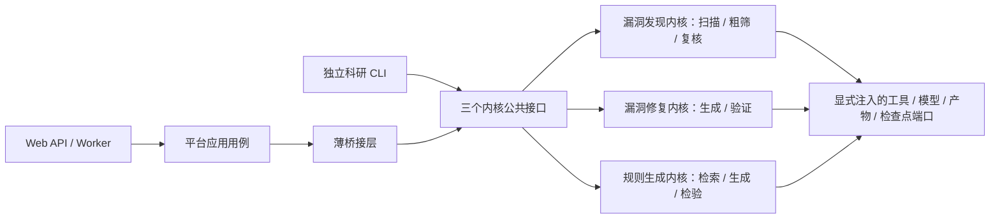

# 科研内核与平台后端解耦：评估与 TODO

记录时间：2026-11-10T14:08:02+08:00。范围：当前工作区（包括未提交实现），并非仅 Git HEAD。
当前状态：S1～S5 的限定解耦交付已验收，S6 仅统一状态与后置清单。S6 已完成，23 项轻量检查通过。各任务的原阶段内容保留在历史折叠区。
本文是本次解耦任务的主 TODO；[数据契约](backend-decoupling-contracts-20261110.md)和[代码边界](backend-decoupling-boundaries-20261110.md)是实施规格。
这不是 BenchmarkPython 方法改进任务，不替换其既有 TODO / 改进树，不启动或扩大实验。

## 用户追加的最终操作验收（2026-11-13T11:36:00+08:00）

DEC-ACC-000 | 2026-11-13T11:36:00+08:00 | completed：已制定[操作验收清单](backend-decoupling-acceptance-checklist-20261113.md)，实际执行项 DEC-ACC-001～010 均为 planned。按用户要求，下一轮隔离启动真实 GUI 和现有 CLI（不新增 TUI），以固定小样本验证双入口契约及迁移前后兼容；不部署实际平台实例，不新增重构阶段。

[操作验收前代码复核](backend-decoupling-code-review-20261113.md)发现独立 discovery 的仓库路径依赖、Docker workspace 缺失和规则 CLI 顺序说明冲突，需最小复现/修复。原 S1～S6 状态保留其既有限定证据；不能据此将本次实际运行验收提前记为通过。最终只关闭影响“三内核、同一 core、CLI/Web 完整正常使用”的阻断，不进入后置清理/实验扩展。

## 交付状态索引（2026-11-13T11:16:55+08:00）

三内核、四个必需切片已经交付；完成是 CLI/Web 边界验收，不代表真实模型效果提升或实际平台部署。

| 状态 | 稳定任务 ID | 范围 |
| --- | --- | --- |
| completed | DEC-000～009、DEC-011、DEC-012、DEC-014、DEC-015 | 本次代码、契约、双入口与必要恢复验收；DEC-012 不包含实际实例部署 |
| planned | DEC-010、DEC-013 | 历史实验脚本迁移、历史副本清理等后置维护 |
| planned | DEC-POST-001～004 | 分流后的历史清理、实例部署、实验管理/效果评测、全面 CI/wheel 整理 |
| completed | S6 | 能力/文档一致性与轻量边界检查，23 passed |

当前入口、契约版本与后置范围见[一页交付摘要](backend-decoupling-delivery-20261113.md)；测试原始证据见[S5 矩阵](backend-decoupling-s5-matrix-20261113.md)。下方历史记录中的“未完成”只描述记录当时的状态。

## 已验收的交付目标与执行顺序（原范围冻结于 2026-11-12T11:29:15+08:00）

**用户确认的交付：三个实验 core 与平台分离，每个 core 只有一份当前算法实现；极简 CLI 直接调用 core，完整平台通过薄适配调用同一 core。两端以一致的数据契约完整正常使用，使实验与平台可以分别推进。**

- core 包含双引擎漏洞发现、完整漏洞修复（native / OpenHands）、基于 RAG 的 QL 规则生成。CLI 和平台都不能另养一份当前算法。历史恢复所需 legacy 可以保留，不要求为目录整洁立即删除。
- 极简 CLI 允许提供源码/上游结果、方法参数、资源配置与输出位置；执行 ID、内容摘要、Prompt 引用等机械装配由本地入口完成并可查看。保留完整 RunSpec 的高级入口，但不能把手写整套底层协议、启动平台或编写 Python 胶水当作日常使用前提。必要批准/恢复必须可从 CLI 完成。
- 平台保留用户权限、任务编排、前端展示、人工确认/接受/发布；薄桥仅装配输入、映射身份/产物和投影结果。相同科研参数在两端含义一致，不得漏传、静默覆盖或降级验证选项。平台 DTO 不要求与 core JSON 字节相同。
- 契约覆盖请求、结果、必要产物、状态/错误及已有交互流程；保留类型声明与发送/接收端语义注释，不新增 AGENTS.md 规则。契约允许显式演进；不承诺 core 永不变化，不为假想兼容建设新框架。
- **不作为完成前置**：抽象优雅、全目录整顿、全面历史脚本迁移、新通用实验管理、批次/消融框架、扩展治理和方法效果评测。保留已有基础设施，停止无实际双端阻断的扩张；不因方向调整推倒重写。
- 正确性仍是必要条件：原方法/Prompt/参数语义不因搬迁悄悄改变，失败不伪装成功，证据和产物不串任务，技术通过不替代人工决定。验证聚焦这些真实使用边界，不追求无关穷举。

**已执行顺序**：按下面的五个收尾阶段逐个关闭；每阶段必须满足结束条件后才进入下一阶段。收口 native 完整链路，并补其 CLI 入口与双端契约验收 → OpenHands 同样接通 → 规则生成/批准/检验同样接通 → 三模块双端总验收和活跃入口归一。发现已接通的路径补同一口径验收。CLI 不再等全部平台迁移后才处理；每个模块同时核对 core、CLI、平台三列。

下文 P0～P5 是任务分类和历史计划，不再按“大基础设施全部完成后才做功能”串行执行。DEC-010 的实验脚本批量迁移及 G5 效果评测明确后置，不阻塞 DEC-012/整体解耦交付；其 planned 状态保留，不冒充已完成。后置项未完成不等于本次交付未完成，必需功能 unsupported 则不能宣称完成。

关联设计文档若仍要求更大范围的基础设施或整理工作，以本节当前交付范围为准；已有公共字段语义仍须保留或显式变更，不能以范围收缩为理由静默删字段、改默认值或绕过必要交互。

### 最终收尾边界（本次完成只认这一节）

本次解耦在以下条件全部满足时结束：

1. `discovery`、`repair`、`rules` 各有一份可被两个入口调用的当前 core；core 不依赖平台用户、审计/阶段 ORM、Web、Celery 或平台配置。
2. 独立 CLI 在没有 backend、平台数据库、Redis、HTTP 服务时，能够完成三个 core 的最小真实流程：输入、执行、结果查看；需要人工批准的规则流程还必须完成批准和恢复。
3. 平台正常 Web 流程通过薄桥接调用同一 core，保留现有前端需要的发现、修复、规则结果、Diff/证据、人工确认/接受/发布语义；桥接只做装配、身份/引用转换和结果投影。
4. 两入口使用同一份请求/结果/状态/错误/产物引用契约。用相同冻结输入和方法参数对照时，送入 core 的语义、返回结论、失败/等待状态和必要产物一致；入口自己的 ID、时间和展示 DTO 可以不同。
5. 四个必需模块切片（发现、native 修复、OpenHands 修复、RAG 规则）均无 `unsupported` 的正常路径；失败、取消和规则批准恢复有明确结果。仅代码存在、import 成功、局部测试或平台旧路径可用不算完成。

本次明确不做：算法改进或重写、抽象层美化、全目录重构、删除全部 legacy、迁移全部历史脚本、batch/消融平台、全面效果评测、新消息系统、新存储后端、全面 CI/文档治理，以及真实平台实例部署。它们可以另立任务，不得阻塞上述五项。

### 收尾阶段（阶段必须收紧，不跨阶段扩张）

| 阶段 | 对应任务 | 只做的事情 | 结束条件 | 禁止借机扩展 |
| --- | --- | --- | --- | --- |
| S1 Native 修复收口 | DEC-007、DEC-009、DEC-011 | 完成当前 native 的 rescan、suite/before-after、project tests、平台后续任务；补 CLI 最小 run/inspect/取消及必要输入装配 | 同一冻结修复请求分别经 CLI 和 Web 进入同一 native core；参数、失败、检查收据、Diff 引用对照通过 | 不做 OpenHands、规则、新运行框架或历史清理 |
| S2 OpenHands 双入口 | DEC-007、DEC-009、DEC-011 | 将已有 OpenHands 算法接到 core public；补 CLI 与平台薄桥的资源/工作区/结果转换 | CLI 与 Web 都能实际启动同一 OpenHands core；资源缺失、超时、失败和结果引用可见 | 不改 OpenHands 算法，不扩展通用 agent 平台 |
| S3 RAG 规则双入口 | DEC-008、DEC-009、DEC-011 | 接通规则生成、编译/开发检验、批准/恢复、平台投影；保留发布在平台 | CLI 可独立批准恢复；Web 可完成规则生成到验收/发布；查询、语料、fixture 变更会被拒绝 | 不做批量实验、holdout 平台或新评测体系 |
| S4 发现与契约对照 | DEC-006、DEC-009、DEC-011、DEC-014 | 对现有发现 CLI/Web 路径补同一输入/参数对照；补发送端/接收端声明和缺失字段修复 | 发现四操作的 core、CLI、Web 均可用，静态/Scout/复核失败语义和实体引用一致 | 不重写已接通发现算法 |
| S5 总验收与收尾 | DEC-012、DEC-013、DEC-014、DEC-015 | 跑最小四模块双端矩阵，确认新入口不走两份当前算法；标记旧入口 legacy/facade；更新 TODO/README | DEC-015、G6 证据齐全，所有必需正常路径不再 unsupported；后置项列为单独任务 | 不新增功能、不因清理而改变算法或历史结果 |

阶段交付只记录实际通过的 core/CLI/Web/契约证据；阶段未满足结束条件时，状态保持 `in_progress`，不得用测试数量或新增文件数量替代。

迁移过程评估与阶段快照（历史；当前状态见顶部和各 DEC 条目）

### 按新目标复核已有改动（2026-11-12T11:18:52+08:00）

本次为监督侧源码审查，未重跑测试；进行中的新增代码不能仅因存在而算验收通过。历史测试证据保留原范围。

| 已有改动 / 证据位置（包内路径简写） | 新目标下的判断 | 后续处理 |
| --- | --- | --- |
| contracts / research / research_cli；`research/public/runs.py`、平台 `research_bridge/*_runtime.py` | 已建立正确的单向边界；CLI 和平台已能调用相同 public 内核 | 保留，继续按实际功能接通，不重设计包体系 |
| `research_cli/src/semflow_cli/main.py` | 有 run/inspect/cancel，仍要求完整 spec/resources；没有批准/恢复命令，规则等待后无法只靠 CLI 完成 | 属于交付阻断；增加最小输入装配和必要交互，复用 public，不复制算法 |
| discovery public 与扫描/复核桥接 | 已有实质迁移；现有边界测试不等于逐模块双入口语义验收 | 补同一输入/参数的 CLI 与平台对照，按证据收口 |
| `research/public/repair.py`、`research_bridge/suite_requests.py`、`comparison_requests.py`、`tests/test_research_repair_workflow.py` | native 的生成、suite、比较已有代码及工作流测试；最新完整验收以主会话实测为准 | 收口当前链路，并从 CLI 验证；不重复造验证框架 |
| `research/runtime/repair_operations.py`、`research_bridge/repair_requests.py` | 非 native 明确拒绝；提取 OpenHands 源码不等于功能已迁出 | 完成 OpenHands core + 双端连接，不把 unsupported 当兼容完成 |
| `research/runtime/rule_operations.py`、平台 `research_bridge/` | 独立生成/批准恢复已有；validate、项目重放等仍拒绝，规则平台桥接尚缺 | 保留原 RAG 方法，补完整技术路径及两端交互 |
| `research_cli/tests/test_independence.py` 与现有桥接测试 | 已证明 import 隔离和局部流程；CLI 测试主要覆盖 help/schema/validate，没有三模块实际 CLI/平台对照 | DEC-015 补少量直接验收，不以总测试数量代替可用性 |
| 执行账本、产物摘要、资源冻结、检查点、安装验证 | 部分承担现有输入/恢复正确性，有实际价值；不是本次产品目标 | 保留可用实现，仅修影响两端运行的缺陷；依赖/打包未变时不反复全量安装验收 |

### 上一阶段实施快照（2026-11-11T15:28:07+08:00，历史证据）

- **本次解耦必需**：完整算法归科研包；CLI 直连 public；Web 薄桥接调用同一算法；保留 API / 展示、人工决策与实际验证边界；新执行显式绑定，旧历史不改写。优先按发现→完整修复→规则推进双入口纵向链路。
- **后续科研基础设施增强**：通用实验管理、额外资源治理、全面指纹证明、扩展批次/消融管理不作为解耦前置条件。仅补实际迁移必需的冻结输入、产物/身份转换、证据、失败与恢复保护。
- discovery 的 scan / scout / review / discover 已接通独立 public；**新上传扫描（含双引擎）、普通 Scout、统一复核方法 4～12 已由 Web 薄桥接调用同一内核**。平台保留原阶段、候选、证据、材料、SARIF API；平台 ID 与科研 ID 分开，旧哈希与 SourceManifest 哈希明确转换。
- 新增 research_audit_binding / research_binding；不存在绑定的历史任务保留原 executor/checkpoint。科学结果与平台投影分开提交，已发布收据可重投影，不重复调用模型。未知 running 结果不自动重放。原始平台源码或绑定被改动时拒绝投影。
- 新科研 Scout 的窗口补审引用已接通：新执行只读取冻结地图、候选、证据和已完成窗口引用，删除旧科研工作目录后仍可继续；历史未绑定 Scout 的原补审仍可用。旧算法重复实现尚待限定到 frozen legacy / facade，不能宣称发现模块已全部完成。
- CodeQL 数据库/SARIF 已以 StaticBaseline 交给下游复核；保留真实工具版本、源码身份、源码前缀和冻结补充规则。实际 CodeQL 小样本再次通过：漏洞第 5 行命中，安全第 8 行无对应报告，数据库归档 583989 字节并成功导出。记录在 `artifacts/decoupling/real-scan-baseline-20261111/`，不扩大实验。
- native repair generate 已接通，suite / before-after / rescan / OpenHands 的完整公共路径和平台桥接尚欠；rules method 8 已接通 RAG 生成、开发图、typed 批准暂停/原检查点续接，跨进程不重新生成有替身回归。项目重放、holdout、独立 validate 和 rules 平台桥接仍待完成。
- 独立与桥接联合回归最新为 **151 passed / 2 skipped**；本轮一次性 PostgreSQL **53 passed / 2 deselected**，此前另一次旧平台兼容选择为 72 项。新增绑定迁移的升级、check、回退/重升均通过；实际平台数据库未迁移或重启。模型与大部分工具为明确替身，不能作为效果验收。
- 严格离线 wheel 安装 v7 已通过 63 个锁定运行依赖；新 v8/v9/v10/v11/v12 已分别构建并校验；v12 包含阶段 2B 修复资源/预算/不可变投影 codec 最新接口。anyio 原问题是脚本忽略 lock resolution-markers，已修复；未放宽锁。旧科研收据按原保存 JSON 核验，不因新增默认值重算历史摘要；变化后的请求/实现不可继续冒充旧执行。
- 18 类 JSON 契约有类型/Schema 与双端注释；run 语义修订 4、result 修订 3、bundle 修订 2，新增真实 baseline / rule_toolchain，保留 SARIF 列与补充规则来源。约束没有新增到 AGENTS.md。

## 上一轮实施断点（2026-11-10T17:27:39+08:00，历史记录）

- DEC-001～005 保持 `in_progress`，尚未满足各自全部验收条件；本次实施被中断。
- 迁移前 549 个代码 / Prompt / 测试 / 配置文件已冻结到忽略目录 `artifacts/decoupling/baselines/20261110T152154-ebb9cb83/`。归档 SHA-256：`2241989b58b3889a12a3b221fb141d6b9e3d3ac9af7b5569f72c0facb2dde01e`。没有归档 `.env`、真实上传项目或审计产物。
- 已在一次性 pgvector 数据库上运行改造前基线：`test_verification_lifecycle.py`、`test_repair_selected_suite_graph.py`、`test_runtime_execution.py`，14 passed / 2 deselected；真实模型 / Docker 验证器由显式测试替身替代。原平台数据库未改动，临时容器已停止并自动删除。
- 已新增 contracts / research / research-cli 包源码，三个模块的类型化输入输出、公共边界、本地产物 / SQLite 执行账本 / 源码证据核验及 CLI 的 validate / schema / capabilities / inspect 初版。算法尚未迁移；公共 execute 明确返回 unsupported_operation，不宣称可执行科研任务。
- 已开始迁移平台后续验证：移除修复服务中的投递调用，新增应用层 dispatch / repair_followups、StageFollowup 事务意图和迁移 `c1d202611100`，由平台 runtime 触发；这些新行为尚未完成回归。
- 已增加契约负例测试源码，但尚未运行；旧自动投递相关测试仍需按新职责更新，并新增重复投递、崩溃补偿和失败保留测试。
- `uv lock --offline` 因本机缺少 astroid 解析缓存而失败；`system/uv.lock` 尚未同步新增 workspace 包。独立 wheel 构建 / 安装、架构导入约束、lint 与改造后回归尚未完成。
- 续接顺序：先审查本次未验证改动并修正边界 / 恢复逻辑，补全锁文件和测试，再更新任务状态；不得将这批初版代码当作完成的独立内核或生产可用版本。

## 当前 S1 实施收口（2026-11-12T11:40:59+08:00）

历史 S1 记录覆盖 native core/Web 与高级 CLI 的 suite build、rescan、project_tests、before-after/StageFollowup/接受链路，不包括极简装配。该缺口于 S1 | 2026-11-12T15:47:30+08:00 | completed 补齐：新增 `repair-native` 复用 OpenHands 的本地装配，独立进程直接运行/inspect、原证据确认和科研参数对照通过；终态 cancel 拒绝改写结果。证据 `research/tests/test_native_minimal_cli.py`，与既有极简 OpenHands/导入隔离专项合计 12 passed。旧三进程测试仍只代表高级 `run --spec`，不能替代此新证据。整体 TODO 不完成，后续集中 S3。

## 当前 S1 真实门补充（2026-11-12T11:44:06+08:00）

175 项科研/桥接回归、CLI 三进程和真实 CodeQL/Docker 完整 Web native 小样本门通过；一项旧平台 PostgreSQL 53 项回归及迁移检查此前通过。完整 OpenHands、rules、发现双端对照和总验收仍未完成。连接已删除测试端口的失败不作为代码失败证据。

## 当前 S2 实施状态（S2 | 2026-11-12T15:27:00+08:00 | completed）

S2 结束条件已逐项补齐：OpenHands 由同一 research core 执行；独立极简 CLI、Web 薄桥、冻结配置/Prompt、worker 字节身份、调用预算与不可变收据均已接通。成功、资源缺失、失败、超时、取消、预算耗尽、篡改和重复投递有边界验证；Web 的 suite 生成/导入、rescan、前后比较与人工接受链路也覆盖 OpenHands。

| S2 列 | 实际证据 |
| --- | --- |
| core | `test_openhands_process.py` 真实子进程/握手/预算与收据；`test_openhands_scope.py` 实际读取权限、文件数与已观察窗口拒绝；`test_openhands_sdk_gate.py` 固定 SDK 1.56.0 + 禁网 Docker + 独立语法检查 |
| 极简 CLI | `repair-openhands` 自动装配执行 ID/摘要/Prompt/原证据确认；`test_openhands_minimal_cli.py` 在禁止平台导入的新进程完成运行、查看、取消，未知调用保留占用 |
| Web | `test_research_openhands_process.py` 相同冻结输入经 Web/独立 CLI 的成功与失败对照；`test_research_repair_workflow.py` native/OpenHands 的 API→suite→rescan→比较→人工接受 |
| 契约 | `OpenHandsPolicy`、`OpenHandsReceipt`、资源中的 worker 文件摘要、`AttemptRecord.engine_receipt`/`Failure.detail` 及真实收发端注释；wire/Schema 检查通过，旧 usage-only 收据保留原语义 |

最终相关回归 **208 passed / 6 skipped**，Ruff lint/format 通过。额外真实 SDK/Docker 门 **2 passed**，包含真实 Web 薄桥与独立 CLI 对照；同一补丁 SHA-256 为 `688a671a08071f40df79a63b6e17045cc260e8aa2a01d08be9302842ad15b545`。证据：`artifacts/decoupling/real-openhands-sdk-20261112-s2-v3/`。模型为明确替身，仅一个合成文件，不是方法效果评测。前次 `12:37` 的完成表述确实过早；本次以这些新增边界证据关闭 S2。

S2 关闭后整体 TODO 仍在进行，S3 规则尚有平台独立 validate API 缺口，S4 发现限定双入口已完成，S5 活跃入口归一未完成。S1 原有三进程 CLI 实际只覆盖高级 `run --spec` 的证据缺口，已由上方 15:47 的 native 直接命令测试独立补齐。

## 当前 S3 实施状态（S3 | 2026-11-12T22:10:00+08:00 | in_progress）

规则 core 已接通 method 8 RAG、编译/开发正反例、原项目重放、typed 批准恢复和独立 `rules.validate`；`RuleResult` 区分开发样例、项目重放和独立检验。未选择 holdout 必须 `not_evaluated/draft`，不能成为发布资格。冻结语料一次性物化为 CorpusSnapshot，检索不再查询平台知识表；资源、版本、完整分块、部分向量身份和 provenance 保留。rule diagnostics 保存编译、开发、重放和失败产物；原始 CodeQL database/SARIF/source prefix 的项目基线接收与篡改检查已接通。

CLI 已提供 `rule-generate`、`decide`、`resume`、`rule-validate`，在禁止平台导入的新进程完成生成、批准/拒绝、恢复、独立复核和终态 inspect。Web binding 调用同一 `research.public.rules`，正常生成、项目重放、批准恢复、RuleVersion 投影、人工根因确认与发布门通过；缺失或不匹配输入明确 failed 并保留 diagnostics，不回退旧 ORM 算法。同一冻结 method-8 请求的 CLI/Web 结果语义对照通过；平台独立 validate API 暂不暴露为新的产品操作。

当前证据：合同/研究/CLI/规则保护和桥接专项 **172 passed / 3 skipped**；真实 CodeQL 2.23.5 + Python 3.11 固定微样本 **1 passed**。S3 仍保持 in_progress；S4 发现四操作限定双端专项 **35 passed**，证据见 progress，S5 总矩阵仍待收口。详细映射见 [S3 规则双入口设计](backend-decoupling-rules-s3-20261112.md)。

## 当前交付状态（S6 | 2026-11-13T11:22:31+08:00 | completed）

S3 规则等价产品验收、S4 发现四操作双入口和 S5 最小总矩阵已通过。四个科研切片均有独立 core、最小 CLI、Web 薄桥、契约声明以及必要失败/恢复证据；新未绑定执行不再按入口选择另一份当前算法。矩阵与证据见 [S5 总验收矩阵](backend-decoupling-s5-matrix-20261113.md)。

交付范围已完成；DEC-001/004/005/006/007/009/012 已按限定交付更新为 completed，原阶段记录保留。部署、历史清理、实验管理与全面 CI/wheel 整理分列 DEC-POST-001～004，尚未启动。

## 1. 结论与不可退让的目标

可以分离。采用同仓库、独立 Python 包、进程内调用作为第一步，暂不引入微服务或远程 RPC。
主要问题是职责和运行身份绑定，单纯搬目录、再包一个 CLI 或 HTTP 接口无法解除这些依赖。

**科研 CLI 必须与 Web 系统实例完全分离，直接链接三个科研内核。**
科研 CLI 不经过 `app/runtime`、平台 service、HTTP API、Celery 或平台数据库；不创建内部用户和 AuditRun 来满足算法入口。
Web 独立拥有其业务生命周期，通过薄桥接层调用相同的内核公共接口。两条入口不互相调用。

三模块是科研边界，四阶段仍是产品流程：发现包含静态扫描、独立粗筛和统一复核；人工确认属于使用方决策。
修复与规则生成是基于显式输入的两个下游分支，规则生成不强制依赖修复成功。
前后对比计算和验证证据属于内核能力；前后 Diff 展示、任务自动串联、补丁接受、规则发布属于平台。

## 2. 迁移前实现评估（历史耦合证据，2026-11-10）

### 2.1 静态检查口径

对 `system/backend/app/**/*.py` 做 AST 导入检查，排除 Alembic；198 个文件均解析成功。
计入函数内显式导入，按文件去重，不推断动态导入、运行性能或算法质量；行数含空行和注释。
`persistence` 统计仅计直接导入 `app.persistence`，未计通过 `app.models` 或其他 service 的传递依赖，因此是下界。

| 区域 | Python 文件 | 行数 | 直接导入平台 persistence 的文件 | 直接导入 core 的文件 |
| --- | ---: | ---: | ---: | ---: |
| services | 73 | 11006 | 35 | 21 |
| workflows | 11 | 417 | 0 | 0 |
| adapters（含子目录） | 51 | 4843 | 5 | 16 |
| runtime | 4 | 183 | 2 | 1 |
| contracts | 15 | 839 | 0 | 0 |
| domain | 2 | 29 | 0 | 0 |
| api | 13 | 1350 | 9 | 5 |
| cli | 5 | 431 | 2 | 2 |

另有 `system/scripts/benchmarks/` 下 92 个顶层 Python 文件显式导入 `app.*`；这表明迁移面较广，不代表这些脚本都应改写。
现状判断：传输层共享已有基础；科研能力对平台运行模型的耦合高；图节点的体量相对健康。
不是由单个巨型文件造成的杂乱：最大 service 是 456 行，问题主要跨文件分布。

### 2.2 已核对的耦合证据与影响

| 证据（当前路径，行号为本次快照） | 当前职责混合 | 对实验的影响 / 处理方向 |
| --- | --- | --- |
| `system/backend/app/cli/experiments.py:11`、`:31`、`:48` | 导入 SQLModel / engine / 工作区；ZIP 经平台上传用例；创建平台记录 | CLI 仅绕开 HTTP/队列；需新建独立包，直接调用内核 |
| `system/backend/app/runtime/stages.py:61`、`runtime/scans.py:17` | 创建平台仓储、领取任务、装配模型、选择图并写失败记录 | 保留为迁移期平台运行入口；不能搬作实验内核 |
| `system/backend/app/services/repair.py:21`、`:29` | stage ID 构造器加载 ORM、确认状态、取证和文件目录 | 修复输入改为冻结目标 / 证据 / 源码引用，平台归属检查留应用层 |
| `system/backend/app/services/repair_semantics.py:377` | finalize 写 RepairRecord、复制固定文件名、更新 StageRun、自动调度验证 | 分为内核结果发布、平台投影、平台后续任务调度 |
| `system/backend/app/services/repair_comparison.py:186` | service 反向导入 API 路由 `create_stage`，进而投递 Celery | 首批清除反向依赖，改平台应用用例创建后续任务 |
| `system/backend/app/services/rules.py:31`、`:130`、`:150`、`:203` | 检索 / 图中断 / 验证 / ORM 状态 / 发布放在一起 | 生成与技术检验进内核；批准来源、发布事务归使用方 |
| `system/backend/app/services/rule_synthesis.py:264` | 生成器按 StageRun 保存 RuleVersion 和恢复去重 | 内核存 RuleBundle；平台按执行 ID + 规则实体 ID 幂等投影 |
| `system/backend/app/services/scanning.py:40`、`dual_scanning.py:18` | 扫描读取平台已发布规则；粗筛自行创建 StageRun | 平台先解析冻结规则；内核只接收 RuleRef，子执行不创建平台记录 |
| `system/backend/app/services/evidence.py:18`、`:72` | 实际源码核验与 ORM 证据写入紧耦合 | 核验进内核，证据记录采用独立证据 ID 和 ArtifactRef |
| `system/backend/app/adapters/ai/provider.py:41` | bind_stage 读取策略、冻结 Prompt，并用仓储回调写用量 | 模型配置 / Prompt / 用量账本显式注入，不读 StageRepository |
| `system/backend/app/adapters/retrieval/dual_corpus.py:16` | 检索依赖全局配置、平台知识 ORM 和 service | 检索端口隔离；冻结语料快照，提供本地 BM25 和可选向量适配器 |
| `system/backend/app/services/context_materials.py:181` | 从产物目录名反推 StageRun，混合配置默认值与阶段冻结 | RunContext 显式传策略，不以目录 UUID 推断平台身份 |
| `system/backend/app/api/routes/stages.py:199`、`repairs.py:65` | 路由拼展示视图，实施接受门与写人工记录 | 拆到平台 query / application；路由只输入输出和错误映射 |
| `system/frontend/src/api/stages.ts:5` 及 features 中对 result / phase 的读取 | TS 类型与 ORM JSON、内部阶段材料结构绑定 | 首轮由平台投影保持原响应，后续定义展示 DTO，避免前端直接绑定科研协议 |
| `system/scripts/benchmarks/formal_runtime.py:26`、`:112` | 创建禁用 User、AuditRun、StageRun，并接平台产物 / DB | 新实验走独立 CLI / SDK；旧冻结实现与结果保留 |

### 2.3 已有资产应复用

- `workflows/` 已较薄；保留 LangGraph、分支反馈、中断能力，不另造工作流框架。
- Pydantic 请求与模型输出、Scanner / ModelProvider 端口、CodeQL / Docker / OpenHands 适配器可逐步提取。
- 真实证据关联、原快照校验、修复只改已读范围、规则正反例与发布门必须保留。
- CLI 收据、失败类型、重试新 ID、阶段输入冻结、任务领取、用量记录都是迁移基线。
- 现有测试证明若干生命周期行为；本次未运行测试或真实工具，不能据此宣称新边界已通过验收。

## 3. 目标归属与运行方式

| 范围 | 唯一责任方 | 明确不承担 |
| --- | --- | --- |
| 请求 / 结果 / 事件 / 产物 Schema | `semflow_contracts` | ORM、HTTP、算法、配置加载 |
| discovery / repair / rules | `semflow_research` 三个内核 | 项目列表、用户归属、产品任务、前端字段、发布与接受 |
| 极简科研命令、输入装配、必要交互、记录、退出码 | 独立 `semflow_cli` | 导入 `app`、创建平台 DB 记录、调用 Web 实例、另写算法 |
| Web 请求、自动串联、并发策略、归属、人工动作、接受 / 发布 | 平台 `app/application` | 实现另一个算法版本 |
| 平台实体 ↔ 科研协议映射、执行调用、结果映射 | 平台 `app/research_bridge` | 决定算法参数、重做评分、静默补默认科研输入 |
| DTO、中文解释、Diff 下载、报告呈现、进度 | 平台 `app/presentation` | 产生科学结论或改变原始科研结果 |
| 数据集、抽样、独立 oracle、消融组合、统计 | benchmarks 与现有脚本 | 向生成器输入隐藏答案，替平台确认漏洞 |

独立运行的最低验收：新虚拟环境只安装 contracts / research / research-cli；不安装 `app`，不设置平台 DATABASE_URL / REDIS_URL，停止 API / Worker，仍可运行三个模块。
所选模型、CodeQL、Docker、可选检索服务仍是真实外部依赖；“与平台分离”不等于不需要任何工具。
默认科研状态、检查点与产物使用独立本地根目录；平台运行使用其专用根目录与检查点命名空间，不共享可变执行记录。
一组冻结实验可用显式只读包导入平台展示；这是另一个平台命令，不是 CLI 的隐式副作用。

## 4. 数据契约实施约束

详见[完整字段与三模块协议](backend-decoupling-contracts-20261110.md)，这里列出迁移必须交付的边界。

1. 入口为独立 `execution_id`、不可变 `RunSpec`、源码 / 上游产物引用；不接受 AuditRun / StageRun / SQLModel 对象。
2. 结果为有版本的 ResultEnvelope + 类型化 ModuleResult + ResultManifest，禁止用自由 dict 充当最终公共协议。
3. 科研执行身份和平台 audit / stage / candidate / repair / rule 身份分开，由映射表关联。
4. 三种模块分别冻结发现策略、修复目标 / 写权限 / 验证集、规则任务 / 语料 / 检验策略；方法版本与 Prompt 版本独立。
5. 模型判断、操作者决策、执行完成、覆盖完整度、技术检验、独立评分各占独立字段，不能互相推定。
6. 产物以 ID、类型、内容哈希与受控相对路径引用；Diff、源码、SARIF、日志不依赖平台固定文件名。
7. 进度与模型用量走追加事件；事实结果以落盘清单为准。事件可重放，平台投影不得再次调用模型。
8. 恢复 / 批准 / 取消使用明确命令，带执行版本、检查点 / 产物身份；重试和重复实验创建新执行 ID。
9. 平台旧 API 通过投影兼容；无法映射的未知状态显式拒绝或显示不可用，不默认为成功。
10. 开发反馈可进入迭代；独立 holdout / benchmark oracle 结果不得通过 resume 或诊断重新喂入同轮生成。

## 5. 实施 TODO 与依赖

任务格式：稳定 ID | 北京时间最后状态更新时间 | 状态。状态按已验证的实际交付更新。
下面的“通过”指具体产物和行为验收，不是仅完成搬文件。

### P0：冻结基线与协议（已有基础按实际阻断补齐）

**DEC-000 | 2026-11-10T14:23:07+08:00 | completed**

- 完成静态耦合评估、三模块 / 双入口边界、数据协议提案和本 TODO；实际代码拆分未开始。

**DEC-001 | 2026-11-13T11:16:55+08:00 | completed**

- 本次交付：迁移基线和验收输入归档已完成；沿用已保存的快照与收据，不改写历史结果/检查点。
- 已有验收证据：既有 baseline 归档、S1/S2 真实小样本和 S5 固定矩阵。
- 后置范围：全面环境/发行物指纹整理见 DEC-POST-004。

原阶段要求与记录（保留原状态和原文；不表示当前交付缺口）

**DEC-001 | 2026-11-10T17:56:08+08:00 | in_progress**

- 冻结迁移前实现：经确认的代码快照、工作区差异、Prompt、uv.lock、查询包、镜像、语料与测试环境指纹。
- 从现有测试选择小型正反例，记录输入、实际外部调用、证据、取消 / 中断 / 重试与前后对比收据；只存脱敏清单，不提交审计产物。
- 明确现有脏工作区的归属与并行工作，不把未提交实现当 HEAD，也不覆盖用户修改。
- 通过：每条验收样本能指向冻结版本；旧结果、旧检查点不改写。是后续迁移的共同前置。
- 当前范围澄清：复用已保存基线，按实际样本记录版本；全面环境指纹证明不阻塞双端迁移，不重做全项目冻结工程。

**DEC-002 | 2026-11-10T17:56:08+08:00 | completed**

- 按契约文档实现 Pydantic 模型 / JSON Schema、公共 API 类型、错误码、能力查询和兼容性样例。
- RunSpec 使用 discriminated union，三内核各自 operation 枚举，Schema / 方法 / Prompt 分别版本化。
- 测试非法字段、错误模块组合、跨快照证据、错误上游引用、缺失参数、未知主版本；禁止静默丢字段。
- 通过：三个模块的请求 / 结果 / 暂停 / 恢复可独立校验，协议包不导入 app 或科研实现；依赖 DEC-001。
- 本轮验收：九种操作及恢复命令结构校验、错误版本 / 字段 / 证据 / 空检查负例已覆盖；算法执行与实际批准续接不在本任务完成声明中。

**DEC-003 | 2026-11-11T15:28:07+08:00 | completed**

- contracts / research / research-cli 与 backend 为单向依赖；CLI 和内核不依赖 app / ORM / Web / Celery / 平台设置；平台桥接仅导入 research public，新增静态边界回归。
- v7 空虚拟环境装入三个 wheel 和 63 个按 Python 条件分支选择的锁定运行依赖，校验 RECORD、uv pip check、全部模块 import 和 CLI，确认平台包缺失；v8 对本轮源码重新打包验证。不是重新从索引下载。
- 历史五个 Pydantic 依赖报告不能替代完整闭包。之前 anyio 缺失的判断来自校验脚本把同名不同 resolution-markers 的版本覆盖，已修正并补负例，未改变第三方锁定版本。

### P1：切断平台身份（随模块补齐必要适配）

**DEC-004 | 2026-11-13T11:16:55+08:00 | completed**

- 本次交付：独立上下文、源码/产物核验、账本、预算和检查点已支撑三个内核的 CLI/Web 执行；规则跨进程批准恢复、OpenHands 收据和任务隔离已验收。
- 已有验收证据：独立包回归、S2 worker 与 S3 批准/恢复证据。
- 后置范围：新增运行框架或存储后端不属于本次交付。

原阶段要求与记录（保留原状态和原文；不表示当前交付缺口）

**DEC-004 | 2026-11-11T10:57:25+08:00 | in_progress**

- 本轮续接：新增计划子执行绑定、选定输入与原生产者存储分区隔离、基于冻结集合的传递引用核验；已完成结果查询不依赖可变工作目录。修复验证容器使用每执行唯一名称，超时不能清理其他任务。完整恢复命令、向量调用用量和平台装配仍待完成。

- 本轮已验证：状态隔离与嵌套回滚、原生图跨进程暂停续接且不重复生成、持久调用预留 / 未知结果拒绝重放、父子共享预算、源码物化和资源快照。真正的规则批准续接、OpenHands 同口径用量和完整端口装配仍未完成。

- 实现 RunContext、ArtifactStore / SourceReader / Model / Retrieval / ExecutionStore / Checkpoint / Control 端口与装配入口。
- 从 EvidenceService 拆出真实证据核验；从 context_materials 拆出纯材料处理和显式冻结策略；去掉目录反查 StageRun。
- 模型提供者不再 bind_stage / 写 ORM；显式 PromptSnapshot、ModelProfile 与每执行用量账本，OpenHands 用量同口径。
- 本地执行账本采用独占目录、原子结果清单、追加事件；SQLite 检查点适配器按锁定版本引入，平台可注入 PostgreSQL 实现。
- 通过：两执行并行无状态串扰；源码 / 产物篡改失败；模型失败有记录；崩溃不留下“成功空结果”；依赖 DEC-003。
- 当前范围澄清：复用已有端口/账本/检查点，新增存储后端、通用调度框架和与当前模块无关的治理后置。已有记录不足必须显式说明，不为接通入口伪造用量或成功状态。

**DEC-005 | 2026-11-13T11:16:55+08:00 | completed**

- 本次交付：扫描/阶段 binding、实体映射、幂等投影及修复 follow-up 事务意图已接通；调度与接受/发布留在平台，未知外部调用不自动重放。
- 已有验收证据：StageFollowup、投影中断恢复与 S5 四切片矩阵。
- 后置范围：不另建消息系统；实际实例部署见 DEC-POST-002。

原阶段要求与记录（保留原状态和原文；不表示当前交付缺口）

**DEC-005 | 2026-11-11T15:28:07+08:00 | in_progress**

- 本次纵向迁移：新增扫描/阶段 execution binding、实体映射和幂等投影。原修复 StageFollowup 仍由平台应用层调度，完整三模块投影尚未完成。

- 先把 `_enqueue_after_repair` 从 service → API 的反向调用迁入平台应用层，注入调度端口；算法仅返回 RepairResult。
- 平台以事务化 outbox 记录“待调用 / 待投影 / 待验证”意图；初期用现有 worker 扫描补偿，无需新消息中间件。
- 建立 execution binding、实体映射、事件收件去重、投影版本；平台 DB 提交与文件落盘没有伪造的跨存储事务。
- 通过：队列不可用时补丁保留、验证显示未启动；重复消息不重复创建比较任务；依赖 DEC-002、DEC-001。

### P2：按模块完成 core + CLI + 平台

**DEC-006 | 2026-11-13T11:16:55+08:00 | completed**

- 本次交付：scan/scout/review/discover 已经由独立 CLI 与平台调用同一 public discovery；静态/Scout 命名空间分离，partial、未复核候选、取消与 SARIF 身份保持。
- 已有验收证据：S4 discovery 专项 35 passed，S5 总矩阵。
- 后置范围：历史副本清理见 DEC-POST-001；方法效果评测见 DEC-POST-003。

原阶段要求与记录（保留原状态和原文；不表示当前交付缺口）

**DEC-006 | 2026-11-11T15:28:07+08:00 | in_progress**

- 本次纵向迁移：发现已完成 scan/scout/review/discover 的公共执行及 Web 新扫描/普通 Scout/统一复核双入口，含真实 DB/SARIF、冻结补充规则与旧材料/SARIF API。S4 限定的 CLI/Web 四操作对照已完成；新历史算法去重和更完整失败门仍待完成。

- 本轮续接：discover 编排、集合索引、复核派生关系与遗漏候选保留已接通并通过回归；新增四个独立 discovery CLI 命令并完成 Web/CLI 同一 public core 对照；真实 CodeQL 一条合成查询通过。补充规则、静态基线 / 资源完整冻结、最新方法的真实模型与全失败矩阵仍按后置范围保持进行中。

- 本轮已接通 scan / scout / review / discover 公共切片及 Web 双入口，覆盖真实字节证据、SARIF 失败、数据库/SARIF StaticBaseline、冻结补充规则、未知前提、重复交付、窗口补审和取消；独立 scout 不读取静态告警。历史算法去重与更完整失败矩阵仍待完成。

- 抽离 discovery：scan、scout、review 入口与双分支汇总，保留独立粗筛不读取静态告警的约束。
- 平台提前解析冻结补充规则；发现内核只接收标准包 / RuleRef，不查已发布规则表，不自行创建 StageRun。
- 抽离 candidate / evidence / coverage / review batch / root-relation 结果；模型建议与人类确认分开。
- 通过：静态失败、粗筛失败、部分覆盖、未复核候选各自显式保留；伪造证据 / 跨运行身份被拒绝；依赖 DEC-004。
- 当前完成门：S4 已结合 DEC-009/011/015 证明四操作双端使用同一发现内核；真实模型效果比较、扩展失败矩阵和历史代码清理后置。新执行不得走两份活跃发现算法。

**DEC-007 | 2026-11-13T11:16:55+08:00 | completed**

- 本次交付：native/OpenHands 的 generate、build_suite、verify 与平台修复投影、复扫、项目测试、前后比较和人工接受链路已完成；技术检查不替代接受。
- 已有验收证据：S1/S2 真实工具小样本、两引擎 CLI/Web 冻结请求对照与 S5 总矩阵。
- 后置范围：保留历史 checkpoint/executor；清理见 DEC-POST-001。

原阶段要求与记录（保留原状态和原文；不表示当前交付缺口）

**DEC-007 | 2026-11-12T15:27:00+08:00 | in_progress**

- 当前切片：S1 native 与 S2 OpenHands 的科研/平台修复链路已贯通，S2 证据见上表。下面 2B/2C 条目保留历史验证范围；当前状态不再按这些历史缺口判断。整体入口归一及 native 极简 CLI 仍需最终收尾，本项暂不冒充整体完成。

- 阶段 2C（2026-11-12T09:50:55+08:00）：优先完整 native 修复验证与正常 Web 工作流。原 RepairPanel 的 rescan:true 请求和可选 suite 不得通过关闭前端验证规避。先复扫，再 suite build / before-after verify、project_tests 和平台后续任务/接受门；2C 后再完成 OpenHands，规则 Web 桥接后置。
- 当前 2C 仅无 suite 的 rescan:true 路径已接通真实 API/worker/bridge/research graph/投影/旧 API，5 项外部替身集成覆盖清空/仍命中/扫描失败/解析失败/无静态关联；suite 与完整用户工作流仍在进行，不以累计测试数代替验收。2B 历史证据保留原范围。

- 阶段 2B 本轮已验证真实 worker/bridge/native 图/旧 API、恢复/失败/取消和接受拒绝门；修复专项 17 项，严格独立 wheel v12、一次性 PostgreSQL 53 项与真实 Docker 小样本通过。详细口径及修复前次过度声明见 progress 的 `2026-11-11T23:27:53+08:00` 条目。完整 suite / before-after / rescan / OpenHands 不在本轮完成范围，本 TODO 保持 in_progress。

阶段 2B 验收纠偏：此前冻结/分派测试未证明真实 native bridge 全链路与恢复，相关完成表述以本条及 progress 纠正为准。完整 suite / before-after / rescan / OpenHands 仍未完成；明确拒绝未装配组合不等于完成本项。

- 本轮续接：native generate 公共路径及逐次尝试 / 诊断 / 上下文 / 补丁 / 修复后源码 / 技术收据已接通；真实 Docker 合成语法验证通过。未选择的检查不执行、不伪装通过；环境错误保留为 error。suite、前后比较、复扫与 OpenHands 仍待接通。

- 已提取 native / OpenHands、语义取证、验证与比较实现到独立命名空间，并移除平台 ORM / 全局设置依赖；native generate 的公共输入/输出转换、Web 绑定和 RepairResult→RepairRecord/Diff/patched source/validation 投影已接通；suite、before-after、rescan、OpenHands 和接受/发布工作流仍未完成，不视为完整修复链路验收通过。

- 抽离 repair：native / OpenHands、语义取证、只修改已读授权范围、候选反馈、验证和前后比较。
- 输入使用 TargetBundle、PatchScope、SuiteRef；科研内核输出 RepairResult 与逐尝试记录；平台桥接再幂等投影 RepairRecord，不由内核创建平台记录，也不自动投递任务。
- 技术检查不等于补丁接受；Suite 生成、前后验证为 repair 公共子操作，不形成第四科研模块。
- 通过：前置漏洞能复现、补丁后阻断、正常功能保持、环境失败 / 未执行均有独立结论；原快照不变；依赖 DEC-004。
- 当前完成门：native / OpenHands 均从 CLI 和平台调用同一修复实现；正常 rescan/suite/比较/项目测试参数不丢失。正反例用于证明原技术流程保留，不要求任意真实漏洞都修复成功；未修复必须如实返回。

**DEC-008 | 2026-11-13T11:16:55+08:00 | completed**

- 本次交付：method 8 RAG 生成/编译/开发/项目重放、typed 批准恢复、独立 rules.validate 已接通；无 holdout 仍为 not_evaluated/draft。Web 的 approve-fixtures→resume 执行科研验证，confirm-project-match/publish 负责平台人工确认与发布。
- 已有验收证据：规则 CLI/Web 同输入对照、Web 等价验收测试及真实 CodeQL 固定微样本。
- 后置范围：方法效果与扩展实验见 DEC-POST-003。

原阶段要求与记录（保留原状态和原文；不表示当前交付缺口）

**DEC-008 | 2026-11-13T17:10:00+08:00 | completed**

- 本次纵向迁移：method 8 公共 RAG 生成和 typed 审批续接已接通，跨进程不重复生成、拒绝过期 revision/checkpoint/subject/query/toolchain、拒绝后不做验收已有回归。新增独立 `rules.validate` 执行与 `rule-validate` CLI：从批准生成 manifest 重建精确查询、依赖、样本和工具链，独立执行验证，不重新生成。

- 本轮续接：新增冻结语料协议和独立捕获 / 导入适配器，验证集合摘要、完整文档分块、版本、幂等快照和篡改拒绝；真实 BM25 检索与完整范例拼接通过。规则 method 8 公共装配、QL 开发正反例、typed 批准恢复、holdout、独立 validate 和冻结语料输入已接通；平台桥接正常路径、CLI/Web 同输入对照和真实技术门仍未完成。

- 已提取 RAG、生成 / 开发 / 项目重放及规则图，新增冻结语料检索适配器与通用批准校验器；语料导入、公共执行和 typed 暂停/续接已有回归；真实模型、项目重放和发布技术门仍待完成。

- 抽离 rules：检索、材料准备、规格 / QL 生成、编译、开发正反例、原项目复扫和独立技术检验。
- 用语料快照替代平台知识 ORM；本地 BM25 默认可用，vector / hybrid 由显式可选检索资源实现。
- 图暂停输出 typed ApprovalRequest；批准输入绑定当前 fixtures / query 哈希，不读取 RuleVersion.fixtures_approved。
- 将样例验收与发布门拆开；独立 holdout 的执行能力隔离在只读验证适配器，隐藏内容不进入生成上下文。
- 通过：错用途、编译失败、正例漏报、反例误报、批准后改样例 / 查询、holdout 缺失均不可冒充通过；依赖 DEC-004。
- 当前完成门：生成、原有技术检验、批准恢复和独立 `rules.validate` 两端可用，发布仍属平台。现有 Web `approve-fixtures → resume → confirm-project-match → publish` 已证明是等价产品验收路径；科研验证不由平台重复实现。真实小样本 CodeQL/正反例/holdout 已通过。

### P3：极简 CLI（与每个模块的 Web 桥接同步交付）

**DEC-009 | 2026-11-13T11:16:55+08:00 | completed**

- 本次交付：三内核最小 CLI 装配、inspect/cancel 与规则 decide/resume/rule-validate 已完成；新进程禁止平台导入。高级 run --spec 保留，本地日常命令不要求手写内部引用。
- 已有验收证据：独立 CLI 回归、S4 四命令、S1/S2 最小命令和 S3 新进程流程。
- 后置范围：batch/扩展消融和历史脚本迁移见 DEC-010、DEC-POST-003；全面打包整理见 DEC-POST-004。

原阶段要求与记录（保留原状态和原文；不表示当前交付缺口）

**DEC-009 | 2026-11-11T15:28:07+08:00 | in_progress**

- 本次纵向迁移：run 可直达三个内核的已声明实验性切片。CLI 已支持规则 `rule-generate`、`decide`、`resume`、`rule-validate`；retry/batch 与扩展批次/消融管理后置。

- 本轮续接：run 现在可直达实验性 discover 和 native/OpenHands generate；规则另有 `rule-generate`/`decide`/`resume`/`rule-validate`。Schema 新增 bundle_index / corpus_manifest / repair_attempts 等真实体声明。batch/retry、三模块独立 wheel 新源码复核与平台缺失验收仍待完成。

- 本轮增加 run（实验性发现切片）、cancel（请求，不伪造终止）和 capture-source，显式资源文件及凭据环境变量引用；规则控制命令已接通，batch/retry 后置。

- 新包 / 命令 `semflow-research` 直接导入三内核 public API；配置、输入导入、源码快照、根目录和检查点完全独立。
- 支持 discovery / repair / rules 的最小可运行命令，以及必要的结果查看、确认/批准、恢复、取消；重试可明确创建新执行，不要求先实现独立命令框架。batch / 扩展消融后置。
- 由 CLI 或共享 public 装配 helper 生成执行 ID、源码/Prompt 引用与摘要；用户只提供必要输入、方法/资源配置。高级 `--spec` 入口继续保留，不能成为唯一日常用法；帮助/示例覆盖三模块完整流程，不依赖用户另写 Python。
- inspect 读取科研清单；decide 写本地追加决策；批准等待允许跨进程恢复，退出码区分失败、等待与中断。
- 不读平台 `.env`；凭据来自科研配置所指环境变量 / secret resolver，不写 RunSpec；不包含 AuditRun / StageRun 选项。
- 通过：未安装 backend、无平台环境变量、API / Redis / Worker / 平台 PostgreSQL 均不可用时，三个内核均可跑小样本；依赖 DEC-006～008。

**DEC-010 | 2026-11-10T14:08:02+08:00 | planned**

- 范围标记（2026-11-12T11:18:52+08:00）：本次解耦交付之后的实验脚本迁移，不阻塞双端可用和平台切换；本轮只需最小独立调用示例，不展开逐批迁移和效果评测。
- 新实验脚本只编排 SDK / CLI 和独立评分；逐批迁移 formal / vul4py / rule ablation 的新执行入口。
- 固定样本、方法、Prompt、预算、模型、语料与 epoch；使用新尝试 ID，先验证机械等价与口径，再做真实模型小样本可行性验证。
- 旧冻结脚本及历史结果保留；`formal_runtime` 只标注 legacy，不把旧收据“升级”为新实验结论。
- 通过：新实验不 import app、不创建 User / AuditRun，旧收据仍可读；依赖 DEC-009。扩大样本另行安排。

### P4：平台桥接与兼容切换

**DEC-011 | 2026-11-13T11:16:55+08:00 | completed**

- 本次交付：四切片均通过薄桥装配/投影；旧候选、证据、SARIF、materials、Diff 和平台人工接受/发布继续可用。
- 已有验收证据：S5 总矩阵 64 passed / 2 skipped。
- 后置范围：不部署实际平台实例；部署见 DEC-POST-002。

原阶段要求与记录（保留原状态和原文；不表示当前交付缺口）

**DEC-011 | 2026-11-13T18:05:00+08:00 | completed**

- 当前收口：research_bridge 与 presentation 已覆盖 discovery 四操作、native/OpenHands repair、rules method 8 的冻结输入、执行、投影和平台人工/发布边界；旧候选/证据/materials/SARIF/Diff API 兼容，ID/哈希转换显式核验。

- 建立平台 application / research_bridge / presentation 边界，按契约完成 DTO ↔ 科研请求 ↔ ORM 投影。
- 任务执行改为调用三个内核 public API；平台决策、接受、发布继续在应用事务内核验最新身份和权限。
- 旧 Diff / materials / report / logs URL 经 ArtifactRef 解析；不再依赖 `stage_id/repair.diff` 拼接。
- phase / result 兼容由展示投影负责，原科研结果不可因中文解释或前端统计而修改。
- 通过：上传→发现→复核→人工确认→修复→Diff/验证→接受，以及规则批准→验收→发布全链路通过；历史未绑定任务继续 legacy。依赖 DEC-005～008。

**DEC-012 | 2026-11-13T11:16:55+08:00 | completed**

- 本次交付：代码中的研究执行 binding、历史未绑定执行分流和投影恢复已完成；迁移仅曾在一次性测试数据库验收，实际平台实例未迁移/重启。
- 已有验收证据：绑定/历史恢复回归、一次性数据库迁移证据和 S5 矩阵。
- 后置范围：实际实例迁移、发布和回退操作单独留给 DEC-POST-002；本条 completed 仅指代码交付。

原阶段要求与记录（保留原状态和原文；不表示当前交付缺口）

**DEC-012 | 2026-11-11T15:28:07+08:00 | in_progress**

- 本次纵向迁移：新增两类绑定迁移 c2d202611110：新任务写 research 绑定，既有未绑定任务继续旧执行器；收据投影中断可补偿，未知外部结果不重跑。仅在一次性数据库验迁移，未部署实际实例。

- 采用每次执行创建时冻结的 engine binding（legacy / research-v1），先离线对照，再新建任务小范围切换。
- 旧 ID / 旧检查点继续使用旧 executor；不把运行中图或旧 LangGraph state 强行转换到新实现。
- 读路径双兼容，写路径单归属；失败回滚只影响后续新任务。已调用模型的任务不得自动换引擎重跑。
- 通过：新结果投影可重放、旧任务可查 / 恢复、切换可回退；依赖 DEC-011 和对应模块双端验收，不依赖后置 DEC-010。交付时分别说明代码已接通和实际实例是否已部署，不能混称。

### P5：边界固化与清理

**DEC-013 | 2026-11-10T14:08:02+08:00 | planned**

- 对全部活跃调用点列清单后，弃用 `app/cli` 的科研职责；平台兼容命令与独立科研命令明确分名。
- 新执行入口统一使用 core；services 可保留 facade，旧历史恢复所需 legacy 可继续保留并明确用途。不得让 CLI 与平台分别维护当前算法；批量删历史代码和目录美化后置。
- 将导入约束、协议兼容与关键双端行为检查纳入现有测试；补足可运行 CLI 示例和平台使用说明。依赖/打包变化时验证独立安装；全面 CI/文档整理不作接通前置。
- 通过：新 CLI 和三个内核对 app 的显式 / 运行时依赖均为零，平台仅通过 public 使用科研包；依赖 DEC-012。

**DEC-014 | 2026-11-13T11:16:55+08:00 | completed**

- 本次交付：关键 JSON 类型/Schema、语义修订号及发送/接收端 WIRE 注释已核对；方法/Prompt、身份/证据和技术检查/人工决定分离。约束写在接口注释中。
- 已有验收证据：wire 语义与 Schema 检查、批准篡改拒绝及独立导入边界。
- 后置范围：后续接口修改仍须按对应接口注释同步检查两端；不新增 AGENTS.md 规则。

原阶段要求与记录（保留原状态和原文；不表示当前交付缺口）

**DEC-014 | 2026-11-13T18:05:00+08:00 | completed**

- 本次收口：关键 run/result/manifest/evidence/event/approval/control/checkpoint/model/source/bundle/resources/baseline/rule_toolchain/repair/corpus JSON 均有类型、Schema 和发送/接收端注释；CLI、四类 Web bridge 与投影接收语义完成核对。

- 本轮续接：bundle_index / repair_attempts / corpus、规则 diagnostics 和发现 CLI 收发注释均已接入；method_version 与 prompt_version 分离。源码依赖约束和 wire 标记一致性通过。

- 本轮已覆盖 run / result / manifest / evidence / event / approval / control / checkpoint / model_exchange / source / bundle / resources 的 Schema 或对应类型声明、双端注释与标记检查；旧批准对查询 / 样例 / 检查点 / 修订号变化的拒绝有负例。未完成的平台桥接 JSON 必须在落地时同步增加双端声明，因此本项仍在进行。

- 关键 JSON 采用稳定契约 ID、Schema 版本与语义修订号；在输入发送端和接受 / 验证端添加配对声明和对端约束注释。
- 只在对应接口的发送 / 接收端注释和 Schema 声明中要求 Agent 同步检查双方语义、默认值、状态、证据 / ID 归属与恢复兼容性；不修改 AGENTS.md。普通 JSON 不写非法注释，Schema 用 `$comment`。
- 增加契约注释 / 双端标记一致性测试；迁移后禁止 CLI 或内核回调平台实现。

**DEC-015 | 2026-11-13T11:16:55+08:00 | completed**

- 本次交付：四切片 core/CLI/Web/契约及必要失败/恢复矩阵完成，范围是双端边界与可用性；实际部署、方法效果与历史清理不作为本次完成前置。
- 已有验收证据：S5 固定矩阵 64 passed / 2 skipped，详见 S5 matrix 与交付摘要。
- 后置范围：后置工作分列 DEC-POST-001～004，未在 S6 执行。

原阶段要求与记录（保留原状态和原文；不表示当前交付缺口）

**DEC-015 | 2026-11-13T18:05:00+08:00 | completed**

- 按用户新目标完成三模块双入口一致性验收；S3 规则等价产品验收、S4 发现四操作 CLI/Web 对照和 S5 最小总矩阵 **64 passed / 2 skipped** 已完成。旧未绑定任务继续 legacy，新四切片入口统一走 research public。DEC-008、DEC-011、DEC-014、DEC-015 已完成；DEC-006/007/009/012 的历史或后置范围保留原状态。
- 每个模块选择最小固定输入/方法/资源配置，分别经真实 CLI 命令和平台正常 API/worker 进入同一 core。外部模型可用相同录制或脚本响应，不能替换整个 core/bridge；现有真实工具小样本证据按接口变化决定是否复用。
- 对照送入 core 的参数与默认值、源码/目标/证据、返回结论、状态/错误及必要产物。两次执行的 ID、时间和展示字段允许不同；按明确实体映射和内容比较，不要求随机模型输出逐字相同。
- CLI 在平台不可用时完成发现、修复、规则的必要流程，包括本地确认/批准与恢复；平台保留原前端正常选项、Diff/结果展示及权限/人工动作。不能把关闭选项或停在 awaiting_input 当完整可用。
- 同一份科研请求/结果类型由两端使用，接口字段语义变更同步检查声明、CLI 装配、平台映射及接收注释；不新增一套协议框架。
- 交付矩阵逐项列 discovery、native repair、OpenHands repair、rules 的 core / CLI / 平台 / 契约对照证据。必需项全部通过才宣布本次解耦完成；仅后置任务可以保持 planned。

## 6. 验收矩阵与回退标准

| 门 | 必须提交的验证证据 | 不通过时 |
| --- | --- | --- |
| G0 协议与安装 | 非法输入负例；独立安装；检查 import / 平台环境缺失；依赖/打包未变可复用有效证据 | 修实际协议 / 打包阻断，不扩大基础设施任务 |
| G1 基础运行 | 两任务隔离；证据哈希 / 引用核验；恢复不重复已完成外部调用；未知调用状态不自动重放 | 修受影响流程，不重造运行框架 |
| G2 三内核 | 真实 CodeQL / Docker 小样本正反例；模型替身标识；静态/模型/验证失败状态；Prompt 与预算一致 | 退回对应模块，保留失败产物与新尝试 ID |
| G3 CLI 独立且可用 | 最小命令/配置从不含 backend 的环境完成三模块及必要批准恢复；不连接平台 DB / Redis / HTTP；无需手工拼内部引用或写 Python 胶水 | 缺命令/输入装配即未完成，SDK 可用不能替代 CLI 可用 |
| G4 平台兼容 | API DTO 与前端回归；Diff 内容哈希；人工确认 / 接受 / 发布；乱序 / 重复投影与队列失败 | 新建任务退回 legacy，旧执行不变 |
| G5 实验口径（后置） | 新旧方法效果、小样本差异归因、独立评分另行安排；本次保留输入/方法和既有证据 | 不阻塞本次解耦，不将重构当效果提升 |
| G6 同一内核双端契约 | DEC-015 的逐模块 CLI/平台对照；同一方法和选项进入同一 core，结果/状态/产物语义一致 | 修接入或契约差异；任一必需流程 unsupported 就不能完成 |

沿用并迁移 `test_runtime_execution.py`、`test_dual_discovery.py`、`test_review_and_decisions.py`、`test_rule_graph.py`、
`test_rule_synthesis.py`、`test_repair_selected_suite_graph.py`、`test_repair_suite_checks.py`、`test_openhands_pipeline.py` 的有效行为断言。
新边界测试分为 contracts / research / research-cli / platform-integration，不能仅验证函数存在或空列表。
模型替身证明流程与身份，不证明真实模型效果；真实工具和真实模型结果分别记录。

## 7. 风险与当前收口方式

最大风险是更换运行身份时丢失证据关联、规则暂停时误重跑模型，以及把平台成功状态当科研通过。
第二风险是全局配置 / Prompt / 检索默认值随提取改变，导致所谓“重构对照”实际上换了方法。
第三风险是前端消费内部 JSON 较多，API 不变也可能发生语义变化，需要展示投影与关键页面验收。
第四风险是历史实验脚本依赖广；以新实验迁移为主，不追改冻结记录。

当前 core + CLI + 平台 + 契约的限定交付已验收。以下原范围与风险作为维护背景保留；后置任务只有收到明确要求才执行。
原先按大基础设施分批、估算 25–40 人日以及“第一批只做 DEC-001～005”的计划已被本次范围校准取代，不作为继续扩张或延迟功能验收的依据。此处不重新承诺未经测量的工期。
每次汇报给出已验证的双端可用项、实际功能缺口、下一条贯通路径；新增工作先说明解决哪个缺口。完成本次必需验收后，后置研究基础设施/实验脚本/整理任务单列，不以“完成全部历史愿望项”为结束条件。

## 8. 后置任务（S6 仅登记，不执行）

这些任务不改变 S5 的交付结论；实际执行需要新的明确要求。DEC-010、DEC-013 保留原 planned 状态，与下列分流项关联。

**DEC-POST-001 | 2026-11-13T11:16:55+08:00 | planned**

历史算法与旧入口清理：关联 DEC-013。保留历史 executor/checkpoint；后续才移除不再需要的副本，不改写旧运行和收据。

**DEC-POST-002 | 2026-11-13T11:16:55+08:00 | planned**

实际平台实例部署：关联 DEC-012 的运维部分。准备迁移、备份、切换与回退方案后再部署；S6 不连接或迁移实际数据库。

**DEC-POST-003 | 2026-11-13T11:16:55+08:00 | planned**

batch、历史脚本迁移与方法效果评测：关联 DEC-010。批次/消融、formal/vul4py 新入口迁移、真实模型与扩大样本另行安排；既有冻结实验保持原样。

**DEC-POST-004 | 2026-11-13T11:16:55+08:00 | planned**

全面 CI、wheel 与发行物整理：已有安装验证证据保留；后续按实际依赖/打包变化安排 CI、wheel 构建与环境指纹整理。本轮不重打包或刷新历史报告。
