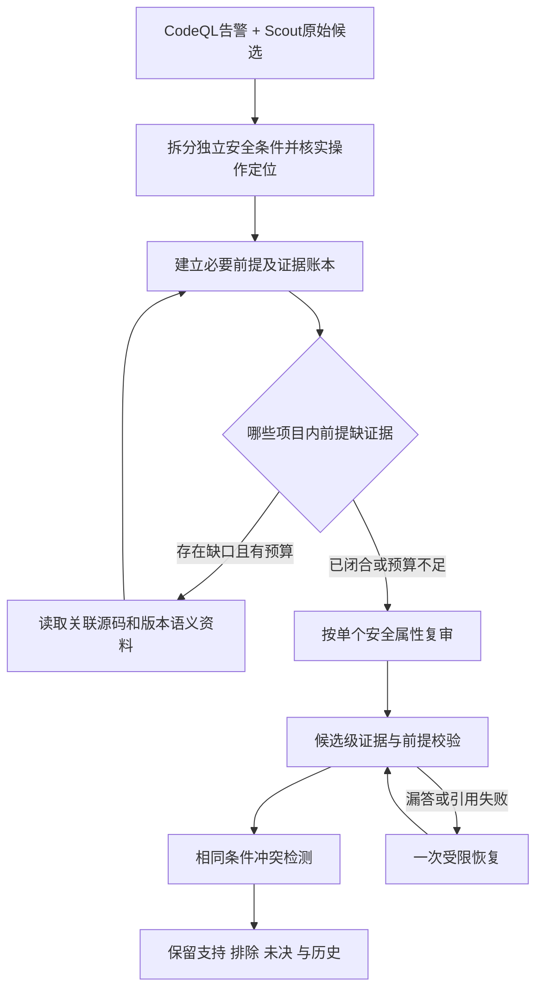

# 审计语义判断与流程可靠性：下一阶段方案

计划形成于2026-10-06，执行更新于2026-10-07。当前默认已升级为 Scout6 / Review8。以下第1—6节保留原始问题与设计依据；实际完成情况见第7节，未实现部分不视为验收通过。

## 1. 先确认改进是否明显

- 输入/调度/任务整改后，严格主条件暂定支持 **16/31→24/31**，业务窗口 **81/81**，唯一候选复审 **124/124** 有结论，4 默认延后窗口及50 unknown任务保留。覆盖方面有明显收益。
- DVNA 输入补入55模板/配置后，相同 CodeQL suite 自己增加一个 gold 根因，两个项目基线12→13。完整粗筛又提高预算，不能把新增8根因全归因于 Agent 提示词。
- **同一完整候选池**，review6(v3)与review7(v4/v5加v6未完成候选补测)最终暂定根因均为 **24/31**。新版 DOM XSS 从 insufficient 到 supported，login 限流从 supported 到 insufficient；Flask error 模板从 excluded 到 insufficient。根因总量没有净增，语义稳定性仍未解决。
- 新版正确排除 ping.ejs 的错误假设：`<%=` 默认转义、`<%-`原样输出；旧复审曾将二者颠倒并支持误报。纠正的是具体语义错误，不代表全局精确率已经提升。
- 该同池观察改变了上下文/语法背景/引用合同/补测批次，费用也不同；不是单因素消融，不计算论文提升、完整precision/F1或部署利用确认。

结果：[覆盖复测报告](../benchmarks/experiments/discovery-coverage-results.md)。诊断：[semantic-flow-diagnostics.json](../artifacts/research/discovery-coverage/20261006-v6/semantic-flow-diagnostics.json)。本次诊断无新增模型调用，原实验计数未改。

## 2. “看到了仍理解不了”的具体成因

| 类型 | 实例 | 当前缺口 | 下一步 |
| --- | --- | --- | --- |
| 框架知识错误 | EJS转义符颠倒 | 自由回忆可覆盖真实语法事实 | 按项目版本提供小型框架语义卡，保留来源和适用条件；代码流另行证明 |
| 安全属性混淆 | users API有登录检查，被推断成有角色授权 | 认证、角色、对象归属未成为不同证明目标 | 三种属性分别核验；登录证据只回答认证 |
| 本地/外部前提混淆 | 全局CSRF/限流middleware未读，却被放进runtime_unknowns | free-text字段由模型自己分类，没有系统核对 | 项目内可读保护为local obligation；外部WAF/代理才是deployment unknown |
| 缺少闭合链条 | DOM sink看到了，关联API正文或写入路径没有一起核验 | 大段源码提供了，但没有明确每段回答什么 | 输入/写入→传播/读取→危险操作→保护/分支的证据账本 |
| 不存在性判断过早 | “路由里没限流”直接判“请求链路没有限流” | 缺少请求路径和挂载顺序的调查覆盖 | 缺保护判断必须覆盖已识别入口/全局middleware/路由/处理函数；未解析边保留unknown |
| 输出粒度不对 | 多端点无认证、限流和日志捆绑 | 一个候选混合多个独立条件，遗漏不显眼 | 独立 endpoint/operation × security property；限流和日志分开 |

这些错误有可改的上下文与证明制度因素；当前两项目不足以定量判断模型能力上限，也不能把模型能力当不可变根因。

## 3. 审计流程中新暴露或仍存在的缺口

### P0：候选失败隔离、恢复与预算

`unified_review_results.save_batch`原子校验所有候选，一个无效引用会回滚整个批次；本轮实际造成4个候选未完成。`UnifiedReview.verify`见到已有batch_id就跳过，包括incomplete；最终校验失败又可能只留下unit_budget，掩盖最初的引用错误。本轮补测来自实验脚本，尚未成为产品的统一恢复策略。

改造：先验证单个候选的结构、真实证据和必要前提，再保存有效子结论；无效/漏答候选单独登记rejected或unreviewed。只对这些身份允许一次受限恢复，父子尝试共享调用/token/时间总限额。取消、快照损坏、跨阶段身份错误直接停止，不能当模型纠错任务重试。原始响应与失败原因保留；broken JSON 不绕过 schema。可选根因关联或新发现失败不应抹掉已验证基础候选。

### P0：位置正确不代表操作已经核实

`grounded`只验证引用的页覆盖指定行；Python绑定检查也根据这一行寻找call。本轮模型常把主行号写偏。普通诊断：同一文件调用在第3行，主位置设第2行仍是合法源码位置，但绑定查询返回空；第3行才识别未绑定`rp`。该问题会绕开原本针对RP陷阱的检查。

改造：以实际AST语句/调用或可引用源码片段确定operation ID、起止行、原文；模型主行只作为待核验定位。多义/无匹配不能自动移动或支持。调用身份校验针对已解析operation，而非靠附近行号猜调用。未知动态绑定继续unknown，不将静态未绑定强行当成运行不可能。

### P1：检查表可填完，语义调查仍不足

`validate_checks`检查任务ID齐全、证据ID存在、非unknown时ID非空，没有验证材料回答了哪个任务。普通诊断表明，仅引用一个README页就可以提交authorization=investigated。当前报告已说明它不是安全证明，但“调查覆盖”仍可能被机械填表抬高。

改造：分别保存任务已分配、源码已提供、前提已回答、结论已核验；检查记录关联具体security property与local facts。文档可以解释业务合同，不能独自证明源码授权保护；not_applicable也需任务相关源码理由。未知任务保留，不靠填齐清单升级完成质量。

### P1：相同条件的不同候选可能矛盾

同轮passport login候选支持“无认证节流”，明确POST login候选却因全局控制未读而insufficient；users API的一个候选曾把authentication当authorization反证。按文件排序组批、可选root_relations没有建立跨批次共享的已核对事实和冲突规则。

改造：安全条件身份由快照、操作/端点、属性构成，稳定区分重复与不同根因；同身份的结论保留历史并检测矛盾。仅矛盾/高影响且证据齐备的项目进入第二视角核查，原裁决可见；未解决矛盾不得输出“确定支持/确定排除”。不用全候选双Agent投票，避免成本普遍翻倍。

### P1：源码堆积与工具异常分类

完整模块预读能补正文，也会增加重复和无关上下文。Scout对gather里的AuditError统一反馈为不可读/禁止，可能掩盖完整性/状态错误；最终快照检查仍阻止成功，所以目前不据此声称已有错误成功结果。

改造：上下文只放当前证明目标所需的真实页、精简事实账本和缺失前提。事实摘要保留页/行/摘要引用，关键分支和变换原文仍在；裁剪注明未提供内容。工具错误按参数、范围拒绝、不存在、完整性、取消、预算分类；只恢复可纠正参数/缺页，不将完整性错误包进普通缺证据循环。

## 4. 新的执行链路

继续使用 CodeQL 与独立Scout并发发现，合流后进入以下流程，不变成纯LLM审计。

证据账本包括：entrypoint、source/write、operation/sink、propagation、guard、branch、framework semantics；每一项保留来源、实际证据引用与established/missing/contradicted/unknown。知识来源不是源码证据，文本调用关系不是已解析可达边。

授权类证明另外明确：subject身份、resource/tenant、operation、必要权限/业务合同、实际guard。没有明确业务合同不能只凭名称“admin”自动判漏洞。缺日志和限流是两个属性。对未知框架先读取依赖与真实封装，不套用不适用语义卡。

确定性事实优先利用现有CodeQL/SARIF、Python AST及成熟语法解析器；不自研通用完整调用图，不宣称能静态解析所有动态middleware。LLM负责解释和提出待证条件，工具负责实际取证与定位。

## 5. 论文依据与适用范围

已重新阅读本地 [IRIS论文](../research/papers/rules/iris-arxiv-v3.pdf) §3.5与§5.5：[文本](../research/papers/rules/iris-arxiv-v3.txt)。它将数据流路径和源/汇上下文交给LLM做告警过滤，并观察到上下文分析收益随模型而异；部分模型效果下降。

本方案借鉴路径与上下文对应、聚焦具体安全条件的思路；还要针对业务授权/状态问题增加权限合同与控制链。IRIS是Java/4类CWE研究，不能用其结果证明本平台Python/JS已有效。候选级恢复和完整性边界是本项目真实失败驱动的工程设计，不冒充该论文的原有方法。

现有SastBench材料适合后续复审基准，VulnGym适合给定线索的证据路径任务，RealVuln开发材料用于回归；具体对齐门槛沿用[论文比较记录](../benchmarks/experiments/paper-baseline-alignment.md)。

## 6. 开发与验证顺序

1. **P0流程可靠性**：候选级失败隔离、原始校验错误、一次受限恢复、共享预算、取消/完整性停止。普通测试用混合有效/无效候选、漏答、重启、重复执行验证，不能靠放松引用门槛通过。
2. **P0操作与属性**：实际statement/sink定位，authentication/role/ownership拆分，endpoint及audit logging/rate limit独立；先用误定位、布尔变量、合法授权、缺角色的正反例验证。
3. **P1语义取证**：证据账本、本地前提补读、版本资料、矛盾校对；模型/调用工具需保持bounded，未解析动态控制链仍unknown。
4. **配对实测**：旧24/31结果冻结；复审使用相同候选池、相同可用源码、相同模型及总预算，独立粗筛新增发现另列，不能混成复审增益。

最小四组：旧复审；仅流程恢复；恢复+属性/证据账本；再加冲突/版本语义。记录支持正根因、FP trap、误删、未决、候选完成、实际定位、局部前提正确性、调用/token/阶段时间。开发集只验证机制，再到未暴露材料判断泛化。隐藏答案只在评测器侧。

重点回归：EJS转义/JS上下文/boolean admin；authentication≠role≠ownership；全局middleware有/无/动态未知；GET logout与POST CSRF分开；登录限流与安全日志分开；RP偏行陷阱与真实alias；单个坏引用不影响其他候选；budget/取消/快照损坏停止；引用知识不能替代源码链条。

功能验收目标：有效候选不被邻近无效候选回滚；已读本地前提不再描述成部署未知；精确operation无法核实就保留未决；自动恢复不重复已完成身份且不越总预算。模型效果以实际配对分数报告，不预设必须比24/31高，也不让现有gold正例决定重试选择。

范围保持：Python/JavaScript为主；无GUI测试、目标服务或利用执行；不改变修复/RAG生成链路。原计划记录至此；执行状态以第7节和实验原始产物为准。

## 7. 2026-10-07 实施与验收状态

已实现：复审按候选隔离坏引用和可选发现，一次受限恢复共享父阶段预算；引用账本合并真实前提IDs而不接受未知ID；候选按安全属性拆分；Python AST与tree-sitter路由清单；精确短引用定位、未绑定调用验证；本地bootstrap补读与缺失前提；调查记录必须包含真实源码和独立可疑候选；检查记录失败单独降为unknown；重复语句引用一次受限定位纠正，展示实际行号与分支，不自动猜位置。调用取消、身份或完整性错误直接停止。

冻结模型批前39项相关普通回归通过，完成后预算/分类/绑定保护合计42项通过，包括定位歧义修复只使用剩余调用预算、有效发现不会被邻近任务回滚。未使用GUI、目标服务或漏洞执行。

未完成：完整动态挂载/调用图、按版本校准的框架语义资料、跨阶段统一冲突裁决、独立人工根因认证、相同预算单因素消融。源码预读和证据账本不能证明所有动态保护都不存在；unknown继续可见。

历史开发结果严格保留：24/31→v3的26/31→v4的28/31。v5/v6的补测修复流程但未增加根因，v7验收与OWASP代表批另见[实施结果](../benchmarks/experiments/discovery-semantic-results.md)。原始模型响应、错误、中断、输入和实现哈希均保留。旧有效结论与追加补测按条件身份合并，最终计数不是新版本一次完整扫描的结果。

OWASP代表批已完成，见[冻结基准结果](../benchmarks/experiments/owasp-discovery-results.md)。本批暴露默认unknown覆盖CWE、类型口径、框架事实冲突与无出处业务合同的问题；分类保存与预算/绑定边界已用普通测试修复，冻结模型结果不改。其余进入下一轮，完整1230例AI尚未运行。

## 8. 通用性验收调整（2026-10-07）

用户要求改进体现于标准基准与独立项目，RealVuln仅作开发回归，停止以累计31/31作为主优化目标。见[通用性复核](../benchmarks/experiments/discovery-generality-review.md)与[验收协议](../benchmarks/experiments/discovery-generalization-protocol.md)。OWASP完整宿主重放与命名/行号变换证实工程机制可迁移；独立新模型端到端泛化尚未证明。分类保留的计分收益不能归作新增语义发现。
