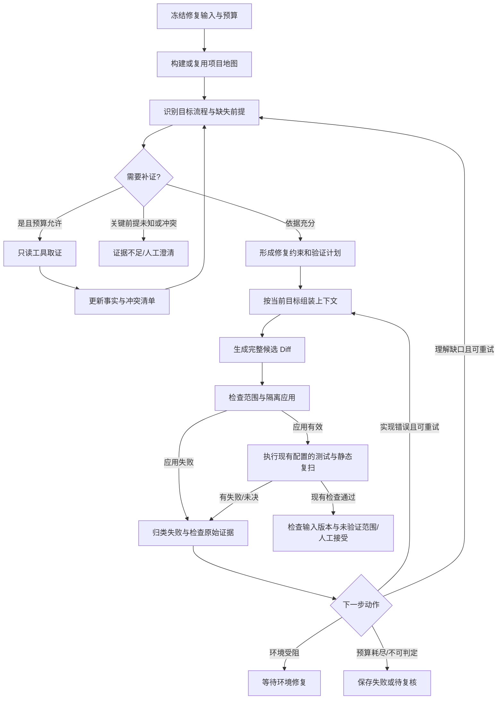

# 业务语义修复编排与验证改进计划

统一开发入口：[修复与规则生成模块后续开发改造总方案](repair-rule-development-plan.md)。本文保留修复详细设计；最新模块范围、开发顺序和共同验收以总方案为准。

2026-10-04。改造起点为 `2b1519b`。**本批分层语义解释、按需取证、冻结上下文及已有检查失败后的有限修复循环已接入默认 repair v2**，历史 v1 保留四节点执行。实现、真实对照及局限见[结果报告](../benchmarks/reports/semantic-development-results.md)。利用重放、根因验证与新增回归仍只是后续设计。

首版保存项目概览、目标流程、修改点解释与带证据事实；细粒度 fact_id/业务约束到测试覆盖矩阵、项目地图缓存、人工澄清 interrupt 尚未实施。下文图/节点表为完整设计边界，不把全部概念节点当已经独立实现；实际图为 prepare_semantics→propose_patch→apply_candidate→validate_candidate→diagnose_failure/refresh_understanding→finalize_repair。

**最新范围决定（2026-10-04）：用户确定修复语义方案，新增复测暂时不加入。当前实施范围为 S1/S2/S3：分层理解、证据约束上下文、基于已有补丁应用/语法或项目测试/静态复扫结果的有限反馈。利用脚本生成与重放、攻击变体、新业务测试矩阵及精细静态差分 V1/V2/V3 均暂缓。下文第 5/6 节保留讨论设计，不作为当前实施依赖或新增验收门槛。**

目标：修复前理解项目和目标流程，明确正常业务行为与安全目标；允许 LLM 按需取证；验证失败后分类反馈、有限修订；用可追溯的证据和可运行的检查评价补丁。

## 1. 输入、范围与最终产物

- 输入：人工确认的漏洞/根因、不可变源码快照、静态路径和已有证据、允许修改文件、依赖/运行配置、可用文档与测试。第一版每条修复链处理一个根因；同根因多位置联合处理，独立根因分开建链。
- 项目概览提供模块与业务地图；目标理解集中在漏洞影响范围。读源码的范围与可修改范围分别控制，允许读取相关调用方并不自动允许修改它。
- 正常行为依据源码、文档、已有测试和明确业务要求；错误行为不因属于旧实现就必须保留。来源不一致记录冲突，关键意图未知时补证或人工澄清。
- 输出：证据索引、项目/流程/修改点理解、业务与安全约束、影响范围、逐次补丁、验证与失败历史、未验证范围、最终 Diff。检查通过后沿用人工接受，不直接覆盖原项目。

## 2. LangGraph 编排

当前图不加入利用校准子图，继续执行用户选择的已有验证配置；检查通过不能自动升级为“业务语义已完整验证”。沿用现有人工接受机制。当前关键语义不足结束阶段；环境失败保存 needs_review 并停止改代码，补资料/环境后重建阶段。图中的人工澄清/环境等待 interrupt 为后续方案。未来第 5/6 节启用时再讨论新的状态与门槛。

| 节点/子图 | 行为与结构化输出 | 进入下一步的依据 |
|---|---|---|
| freeze_repair | 检查确认状态、源码/规则/配置/测试版本；冻结目标、读写范围、总预算 | 快照一致，目标属于本审计且仍已确认 |
| project_map | 先取目录、README、清单、入口、配置和已有结构索引；概括模块职责、关键接口和业务对象 | 缓存与当前快照/依赖/配置一致；未覆盖模块可见 |
| inspect_target | 围绕入口→调用→目标→输出/副作用形成流程；列出关键未知项及拟用工具 | 下一项工具请求对应一个明确缺失事实 |
| collect_evidence | read_source、search_source、调用线索、允许的查询、项目文档/测试读取；限制窗口和范围 | 返回真实位置、版本、内容摘要、原文引用；解析失败显式未知 |
| update_facts | 事实分类 supported/inferred/unknown/conflicting；保留否定条件、版本和冲突 | 引用可读且属于正确快照；不把模型概括自动升级为确认事实 |
| define_contract | 生成业务不变量、预期变化、安全属性、修改理由、影响范围和验证映射 | 每个关键条件都有依据或显式未知；关键未知阻止已验证结论 |
| select_validation | 关联当前已有验证配置与可用测试，列出约束覆盖缺口 | 不自动生成或要求利用测试；测试配置/依赖缺失显式标记 |
| build_context | 按本轮修复/取证目标加载必要事实、约束、源码及失败诊断 | 满足最小必需证据清单，预算足够，不截断关键输入 |
| propose_patch | 输出完整候选补丁及每项变更对应的漏洞/业务约束 | 不修改验证器、测试和配置来隐藏失败；每处变更解释影响 |
| apply_candidate | 每次从原始快照新建副本，检查 old_text、文件范围与原版哈希 | 候选可重放，修改只在副本中发生 |
| validate_candidate | 执行当前已有的语法/项目测试与冻结规则复扫 | 保留原检查状态与日志，失败分类给下一轮；新增测试和精细差分暂缓 |
| diagnose_failure | 先确定性解析失败项，必要时调用 LLM 总结并提出根因假设 | 输出包含失败类别、原始日志引用、受影响约束和下一项行动 |
| route_feedback | 实现错误回补丁；语义缺口回取证；环境错误停到环境处理；资源耗尽保存 | 单次反馈不能同时触发无限读取和无限改动 |
| finalize | 复核现有检查、约束版本、源码/补丁/测试配置哈希；生成报告 | 人工接受门独立，不以摘要或旧验证替代新候选检查；未知约束仍显示 |

当前调用者工具只是语法/文本线索，不能因使用该工具就称完整调用图已理解。使用 CodeQL/成熟语言工具补充解析属于后续能力；第一版对未解析 dispatch、反射和第三方行为保留未知。

## 3. 上下文工程：原始证据保存，模型输入按需组装

分四类持久化产物，避免不断追加整段对话：

1. **原始证据库**：源码窗口、文档、测试、查询、日志不可变保存，记录快照/版本/hash。大文件不进入图状态。补丁后证据另建版本，不能混用旧位置与新行号。
2. **事实与约束清单**：每条具有 fact_id、描述、适用条件、evidence_ids、可信状态、验证映射。模型摘要是可追溯视图，不替代原文。关键前提、反例、冲突和未知不能在压缩中删除。
3. **分层语义视图**：项目地图、目标流程、修改点契约分别保存并可独立刷新。每条结论能回溯原文，标记覆盖范围。项目地图不重复承载所有实现细节。
4. **本轮上下文包**：当前目标、核心约束、相关代码原文、最新候选和验证差异；保存输入 manifest/hash，保证每次模型调用可复查。

建议上下文组成如下。下表 token 份额为后续校准目标；首版采用 40000 Unicode 字符的业务上下文上限，完整可修改文件另限 24000 字符，超过预算停止并要求缩小目标。模型适配器继续约束实际调用/token/时间，没有将下表精确份额标为已实现：

| 内容 | 输入预算参考 | 保留规则 |
|---|---:|---|
| 项目背景/模块地图 | 约 600 tokens | 一次简要概述，必要时展开有关模块 |
| 目标业务流程 | 约 900 tokens | 含输入、权限、调用、输出和副作用 |
| 根因、安全目标、业务不变量、冲突/未知 | 约 1,200 tokens | 必需项固定保留，不能仅为节省 token 删除 |
| 本轮相关源码/调用方/测试证据 | 约 4,000 tokens | 优先原文；按符号去重，控制窗口，保留必要完整函数或可追溯分段 |
| 当前补丁与失败诊断 | 约 1,300 tokens | 初轮留给代码；后续包括完整相关补丁、原始断言/错误片段 |

上表约 8k 是输入规划，系统指令、schema、输出预算另计；小窗口模型需先检验 `输入＋预留输出＋余量 ≤ 模型窗口`。若无法容纳完整必要补丁和关键证据，拆分目标或缩小修复批次，不能硬截断。文件/函数超过现有读取窗口时分段读取并记录未读部分，不能把部分函数当完整证据。

每个事实的来源保存在证据库，不要求每轮都发送所有原文。当前候选涉及的接收器身份、参数约束、权限保护、输出上下文等关键依据必须进入本轮必需清单；其余保留 ID 和读取工具入口。明确区分“已读但本轮压缩”“尚未读取”“模型假设”。

上下文重建与完整性规则：

- 每轮按目标组装新包；历史只保留有效约束、已尝试修改/失败的短索引及最新相关诊断。需要旧尝试时通过 artifact ID 读取，不反复注入整个 trace。
- 以 snapshot＋file＋symbol/window＋content hash 去重，跨原版/补丁版不去重合并。CodeQL 路径、文档版本和返回类型限定条件保留。
- 新证据推翻旧摘要时生成新版本，显式标记被替代事实；不并列携带相互矛盾而无状态的旧结论。
- 项目地图缓存键包含源码、依赖、配置、抽取工具和摘要提示词版本。关联修改影响到的视图须失效；失效依赖未知则保守重建相关视图。
- 调用前检查最小必需事实/证据是否齐全；缺项回取证或不足状态。完整产物保存可防止历史丢失，仍不能保证模型理解整个项目，报告必须列出实际覆盖与未知。
- 日志先解析确定性错误位置和断言，LLM 再解释；原始日志始终保留。不得反复通过“总结上轮总结”压缩关键安全条件。
- 源码/注释/文档/错误信息仍视为分析数据；工具白名单和修改范围由服务端控制，模型不能扩大自身执行权限。

图状态拟用 TypedDict 保存 `stage_id/source_snapshot_id/target_id/overview_id/fact_bundle_id/contract_version/validation_plan_id/oracle_id/current_attempt_id/context_manifest_id/budget/next_action` 等引用和小型状态。事实、原文、补丁和大日志放 ArtifactStore/持久化记录；避免把全部 messages 放进长期图状态。

## 4. 有限循环与恢复行为

- 第一版建议最多 3 个完整补丁候选，累计最多 8 次只读补证；最多 12 次模型调用为局部上限，仍受阶段既有调用/token/时间总预算约束。本批不生成利用脚本。上限可配置，阶段恢复不得重置。
- 工具补证和补丁候选分别计数。重复读同一版本同一窗口优先复用证据；若没有新证据或新修改连续重复，结束并说明停滞原因。
- 后续候选是相对于原始快照的完整补丁；每轮从原版新建目录，不叠加修改失败工作区。上一版补丁及已成功部分通过上下文给模型保留。
- 原版校准、模型候选、补丁应用和验证均有内容键及执行 ID。已完成调用回放校验 receipt/hash；不能只因 LangGraph 有 checkpoint 就假设外部操作只执行一次。
- 候选或契约变更后，相关验证必须重跑；旧验证结果不得沿用到新哈希。修改核心正常行为要求人工确认，不能因测试失败自动放宽。
- 失败、取消、超时、工具不可用和人工等待单列。保留最佳已验证候选，但不得因预算耗尽把部分通过提升为接受。

## 5. 利用重放：验证目标漏洞是否被阻断（暂缓）

**可以将利用方式转换为可运行的安全回归测试。它验证“已覆盖的攻击条件和路径下，危险行为被阻断”，不单独证明所有根因变体消失或整个项目无新漏洞。**

一个有效验证包包含：环境/依赖与快照、入口和请求身份、准备数据、前置条件、触发输入、预期危险行为、成功观察点、安全断言、正常业务对照、清理步骤，以及原版校准日志/hash。返回码只作为执行记录，不能单独代表利用成功或修复成功。

脚本应观察安全影响，例如对测试资源的越权访问/修改、测试沙箱边界之外的标记文件、非预期查询结果或受控副作用。XSS 需要区分字符串反射、可执行输出上下文与实际执行验证；未提供运行时执行环境时只给限定语义证据。脚本不访问真实生产系统或真实第三方数据。

| 版本/场景 | 环境与入口 | 利用危险行为 | 正常行为 | 结论 |
|---|---|---|---|---|
| 原始脆弱版 | 必须正常 | 必须观察到目标影响 | 指定正常对照应通过 | 验证脚本已校准 |
| 已知可信修复版（如有） | 必须正常 | 同一路径被阻断 | 指定对照通过 | 加强 oracle 可信度；缺此版本不自动否定自发现漏洞 |
| 平台候选补丁 | 必须正常 | 原利用及所选变体被阻断 | 正常与边界对照通过 | 目标验证通过，继续综合验收 |
| 任意版本 | 服务未启动/路径未到达/依赖失败 | 无法判定 | 无法判定 | infra_error/inconclusive，不能计修复成功 |

`security_test` 建议采用“断言系统保持安全”的测试：脆弱版因观察到危险行为而断言失败，修复版因为危险行为被阻断而通过。单独的触发脚本可在利用成功时返回成功码；两者方向必须在 manifest 中明确。只认结构化观察与断言，不能把所有非零退出都当原版漏洞，也不能把所有非零退出都当补丁阻断。

实施流程：

1. 从已确认根因和证据构造/导入最小验证包，可使用 LLM 起草，但验证器校验引用、范围和断言。
2. 校准环境、正常请求和入口可达性，执行原版；脚本自身语法/导入错误、准备失败须分开。
3. 原版没有触发则修订脚本或补充证据；仍未触发标未证实/不可复现，不宣称修复。已有人工确认保留历史，不因单次失败自动排除漏洞。
4. 原版校准成功后冻结开发验证器。另从根因条件设计变体，如另一入口、合法边界与不同包装路径；其前置条件分别核实。
5. 修复生成器可读取开发验证与失败反馈，但不能修改验证器。验证脚本保存在修复副本之外，执行前后核对哈希，测试基架不在可改路径中。
6. 对每个新候选在相同环境/初始状态执行同一验证包及正常对照。状态数据库/临时文件每轮独立重置，避免攻击污染和残留掩盖结果。
7. 最终独立变体/功能检查由评测器持有，不提供逐条答案用于修订。若将失败反馈用于调试，则该组转为开发验证，后续不能仍称最终留出测试。

脚本需要更新时生成新的 oracle 版本并重跑原版校准及相关候选，禁止为了让候选通过改变断言。不同 LLM 起草测试与补丁并不自动构成独立真值；应优先既有项目测试、运行时观察、人工审阅或可信参考版本。

2026-10-04 范围收敛：**首版利用验证限定为无需启动服务的进程内单元/组件测试。** 使用现有隔离 Python/Node runner、固定运行时和预装依赖；允许临时文件、内存数据、直接函数调用和无需监听端口的框架 test client。test client 属于进程内组件验证，报告不把它写成完整服务端到端利用。源码不可加载、所需依赖缺失或模块导入会启动外部服务时，明确标记环境受阻。

| 首版验证边界 | 示例 | 可给出的结论 |
|---|---|---|
| 可观察真实代码行为 | JS 原型污染、纯函数权限判断、沙箱文件路径处理、实际模板渲染与转义 | 指定代码层面的危险行为可复现/已阻断 |
| 进程内真实组件 | SQLite 内存库执行 SQL、框架 test client 调用无需外部依赖的路径 | 指定组件和配置下验证通过；不泛化到不同生产数据库/中间件 |
| 只观察危险调用参数 | mock 网络/数据库/进程调用，断言目标 URL、SQL 文本或命令参数 | 调用边界或约束检查通过；mock 不证明真实越界影响发生 |
| 必须真实运行条件 | 浏览器执行 XSS、依赖真实 DNS/重定向的 SSRF、多层代理解析差异、并发竞态、部署权限与会话集成 | requires_environment，首版未执行，不能计安全验证通过 |

先用清单判定 `in_process / boundary_only / requires_environment / unsupported`，再执行验证。结果记录 `validated_scope`、真实组件与替代组件、未覆盖前提；仅当受测安全属性确实能在该层观察时，才称其目标验证通过。即使单元检查成功，依赖真实环境的剩余属性仍保持未决。首版动态覆盖率以全部目标和可运行子集分别报告，服务相关漏洞不得静默从分母删除。

需要多服务、真实浏览器或部署条件的动态验证留待后续独立工作包讨论，不作为首版验收门槛。静态复扫和跨文件源码取证仍可继续，保存“代码约束已改善、运行环境验证未完成”的草稿结论。当前 `--network=none` runner 保持进程内验证边界，不能通过 mock 结果宣称完成完整利用重放。

## 6. 根因与新 bug 的综合验证（新增能力暂缓）

利用重放必须与其他检查共同组成验证矩阵：

| 检查 | 能回答的问题 | 仍需说明的边界 |
|---|---|---|
| 语法/类型/构建 | 候选是否可运行、接口是否可编译 | 无法替代业务、安全验证 |
| 已校准利用与攻击变体 | 指定漏洞行为在覆盖条件下是否仍可触发 | 不能证明全部攻击方式不存在 |
| 原生功能测试＋业务契约测试 | 指定正常/边界行为是否保持 | 原生既有失败需先分类；未映射契约不算已验证 |
| 根因路径检查 | 安全修复位于正确边界，其他入口/分支是否绕过 | 结合代码/动态/静态证据；LLM 意见属于辅助，不是安全证明 |
| 完整冻结规则复扫＋告警差分 | 目标告警变化以及新增静态风险 | 相同行号/规则 ID 不等于同根因；扫描未报不等于无漏洞 |
| 变化影响与回归 | 修改调用方、输出/异常/状态副作用是否被覆盖 | 动态分发等未知依赖单列 |

静态差分在相同工具、规则、依赖和配置下对原版与补丁版运行。用规则＋source/sink/路径＋符号/补丁行映射建立关联，输出 resolved/persistent/introduced/uncertain；同一规则在其他位置新增告警也要检查。关联只是候选匹配，根因不清时不能自动裁定。目标不对应 CodeQL 告警时允许“安全 oracle 已验证，目标静态项不适用”，不能强行要求某个规则消失；整体补充风险复扫仍执行。

功能差分仅用于应保持行为的合法输入。返回值、状态码、异常和数据库/文件/权限副作用应按契约比较；漏洞攻击行为是明确预期改变，随机 ID/时间等仅按有依据的归一化规则比较。现有 bug 不应被复制为正常业务要求。

结果分开存：`reproduction/security/root_cause/functionality/build/static_diff/coverage/human_acceptance`。未验证条件、缺环境、新增未裁决告警以及关键契约未覆盖进入待复核。首次版本只提供“通过指定验证”的 scoped 结论，不生成“没有新 bug”这一绝对状态。

依据：[Vul4Py 2026 原文摘要](https://arxiv.org/abs/2608.00692)采用利用与项目功能配对验证；[作者仓库](https://github.com/tabudz/vul4py)要求先校准原版/参考修复。此处为本平台设计，不移植作者分数或直接采纳其宽松缺功能测试判定。现有 `external_oracles.py` 已有独立 mini 安全/功能样例，可复用为首批机制测试，不等于真实项目通用 oracle 已接入。

## 7. 实施拆分、验收与解耦

| 工作包 | 原因与目标 | 验收 |
|---|---|---|
| S1：证据与语义视图 | 修复目前只拿候选描述和有限文件；增加分层理解与依据 | 跨文件取证、错误版本拒绝、矛盾/未知保留；概要压缩后关键权限/输出条件不丢失；模型可重新读取原文 |
| S2：上下文与约束 | 摘要本身不能约束修复；控制输入膨胀 | 固定约束不被截断、token 上限有效、输入 manifest 可回放；超预算显式处理；读写范围分开 |
| S3：有限反馈图 | 当前没有验证失败后的补证/修订循环 | 失败分类、原版重建候选、最多三次、总预算和恢复不重复；环境错误不引导代码修改；验证失败不可自动接受 |
| V1：利用校准与注册（暂缓） | 防止用无效攻击或环境失败判修复；首版只做进程内验证 | 验证层级分类、原版可观察触发、补丁阻断、正常对照；冻结脚本不被修改；mock 边界与真实影响分开 |
| V2：根因与回归矩阵（暂缓） | 单一 PoC 可被过度修复绕过 | 同根因不同入口、拒绝全部请求反例、跨模块副作用与功能对照；独立检查和开发反馈分开 |
| V3：静态差分与验证覆盖（暂缓） | 默认语法及规则 ID 比较不足；首版不部署外部服务 | 相同规则新增位置能检出；原生测试可运行性、边界及未决范围真实呈现；多服务动态验证留待后续讨论 |

当前顺序 S1→S2→S3；V1/V2/V3 不随本批实施。先使用已有 Python SQL 注入、JS 原型污染样例及其现成检查，再加入可读取相关模块的语义理解测试；不把单个案例三轮重复写成多个独立根因。后续启用 V1 时先校准进程内 oracle；SQL 拼接的 mock 断言单列，不当作真实注入利用。

预期模块按职责拆分：`workflows/repair.py` 只组图；语义视图/上下文/约束/反馈为独立 services；只读取证、校准 runner、静态差分、补丁应用为 adapters；契约、oracle、候选和验证历史分别持久化。复用 LangGraph、现有 ArtifactStore/预算/证据和 pytest/Node/Docker；不另造通用代理框架。单文件沿用 AGENTS.md 约束。

测试以代码/API/CLI 与受限运行时为主，继续不做 GUI 测试。验收检查实际事实关联、失效、错误分类与补丁行为，不以节点数量或提示词存在作为完成依据。模型替身只验证流程，真实模型和运行时结果另报。
