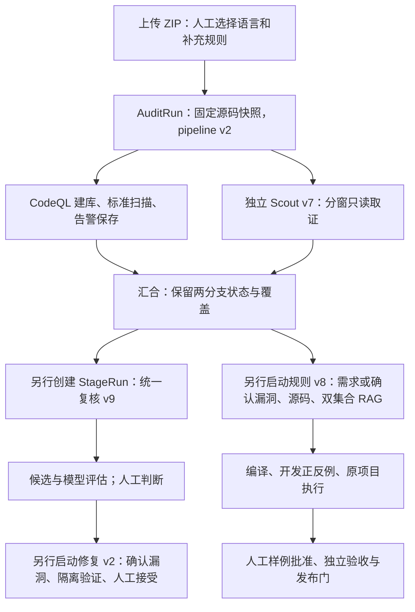

# 工作区迁移与当前实现一致性复核

复核日期：2026-10-09。代码基准：`58d2c8f7ba16d6e2517b1855db593bc8377ec7bd`。

结论：迁移说明中的本地迁移方式、兼容链接、Git 远程、忽略边界和 Compose 项目配置有实际证据支持；当前项目结构也与四阶段原型大体一致。README 的两个默认值、架构图和产品流程存在描述偏差，应用名称尚未完全更新。历史核查数字应明确对应迁移前状态。

本次只增加复核报告，没有修改实现、原说明、配置、数据库结构或既有实验结果。

## 当前项目的实际结构

| 目录 | 当前内容与职责 |
|---|---|
| `backend/app/api/` | FastAPI 路由、所有权检查、上传与阶段创建、人工判断、修复接受及规则发布 |
| `backend/app/contracts/`、`domain/` | Pydantic 输入/输出契约，状态、错误与业务约束 |
| `backend/app/services/` | 双引擎发现、统一复核、证据门、语义修复、规则准备/生成/开发验证等用例 |
| `backend/app/workflows/` | 按执行记录运行的 LangGraph 图；双发现分支、复核、修复、规则与粗筛各有入口 |
| `backend/app/adapters/`、`ports/` | CodeQL 命令/SARIF、兼容模型、检索、源码解析、产物与隔离验证；模型和扫描器协议 |
| `backend/app/persistence/`、`alembic/` | 审计/阶段/证据/候选/判断/修复/知识/规则记录，仓储与版本化迁移 |
| `backend/app/jobs/`、`core/` | Celery 投递/执行、检查点装配及配置；服务用例仍直接调用部分适配器和仓储 |
| `backend/app/prompts/` | 独立版本化 Prompt；存在版本文件不等于当前入口默认启用 |
| `frontend/src/features/` | 上传、任务、CodeQL 详情、AI 复核、修复、规则与知识面板 |
| `frontend/src/client/` | 上游认证等生成客户端；审计业务另有 `src/api/` 客户端 |
| `tests/` | 根项目审计行为测试；`backend/tests/` 和前端 Playwright 目录另保留模板测试 |
| `scripts/` | 本地初始化、知识采集/索引、CodeQL 工具安装与大量研究/基准脚本 |
| `docs/`、`benchmark-data/` | 设计、研究结果、材料索引、实验协议、状态与日志 |
| `artifacts/`、`.local-workspace/` | 仅本地审计产物、比较工具、研究依赖与会话输出，均被 Git 忽略 |

依赖由根 `uv.lock`、前端及 CodeQL LSP 的 `package-lock.json` 固定。后端声明 Python >=3.14；CodeQL Python 抽取器默认使用 `python3.11`。Compose 当前只定义 PostgreSQL/pgvector 和 Redis，API、Worker、前端按 README 在主机启动。

## 当前执行关系



这是执行关系图。阶段通过持久化 ID 和产物关联，用户/API 分别启动后续阶段；当前没有贯穿全部四阶段的单一自动主图。规则样例批准使用 LangGraph interrupt 暂停并释放 Worker。

## 已核对一致的迁移描述

| 说明项 | 本次证据与结论 |
|---|---|
| 项目根目录与迁移收据 | 当前路径正确；项目、work、outputs 的设备号和 inode 均与收据相同，支持同文件系统重命名记录 |
| 三个旧路径兼容链接 | 旧 `ai-code-audit`、`work`、`outputs` 均为有效符号链接，分别指向新项目和 `.local-workspace` 内目录 |
| 环境、依赖、产物迁入 | `.env`、`.venv`、前端 node_modules、artifacts 和本地基准材料目录存在；Python/pytest 入口可执行 |
| Git 历史与远程 | 本地有 14 个可达提交；迁移提交有原历史父提交；origin 为新仓库，legacy-origin 为旧仓库 |
| Git 提交排除边界 | 所检查的密钥配置、依赖、产物、原始材料/答案目录均受忽略规则保护；当前跟踪清单不包含这些目录或本地 `.env` |
| Compose 项目与数据卷 | `.env` 的非秘密项目名为 ai-code-audit；配置解析得到原数据库/Redis 卷名；现有两个容器的项目标签和启动时长与保留服务记录相符 |
| 中段介入仍为设计候选 | 现有双发现图为 CodeQL/Scout 并行；查询适配器使用 database analyze，未找到外部 CSV/GlobalWithState 分轮语义事实链路的生产实现 |
| 实验恢复入口 | state.json 和 journal.md 均存在；next_action 仍为 TEST_PROGRAMS_INPUT_PREP，尚待新预留样本、BAC-Bench 与规则/修复正式准入 |

Compose 配置解析得到 `ai-code-audit_audit-db` 和 `ai-code-audit_audit-redis`。本次只读检查容器，没有启动、重启或新建服务。

## 描述偏差与建议修订

### 1. README 的默认复核版本过时

- 文档：`README.md:14` 写“新阶段默认 review v4”。
- 实现：`backend/app/api/routes/stages.py:74` 创建 review v9、repair v2、rule v8、scout v7。
- `backend/app/workflows/review.py:21` 将 v4–v10 路由至统一复核图；v4 是较早统一复核版本，当前默认是 v9。
- 建议改为“新阶段默认 review v9”；历史支持版本与默认版本分开说明。

### 2. README 把规则版本与默认用途混在一起

- 文档：`README.md:16` 写“默认 v8（漏洞检测用途）”，容易让读者认为默认选择漏洞检测模板。
- 实现：`backend/app/contracts/stages.py:45` 的 purpose 默认是 review_anchor；`frontend/src/features/rules/RulePanel.tsx:35` 同样默认选择复审锚点。
- `backend/app/adapters/codeql/grounded_spec.py:154` 要求 vulnerability_detector、auto/new_query 和支持的操作范围才能进入类型化生成。
- 其他用途/策略仍可能走 `backend/app/services/rule_synthesis.py:127` 的自由 QL 草稿分支。
- 建议明确：“阶段默认 v8；界面/API 默认用途为复审锚点。选择漏洞检测用途并满足范围条件时使用类型化规格/模板。”

### 3. 架构图没有呈现当前默认双发现链路

- 文档：`docs/architecture.md:25` 仅画 CodeQL 建库→扫描→复审；技术表和目录说明使用“主图/子图”表述。
- 实现：`backend/app/api/routes/audits.py:127` 对新上传开启 dual_engine；`backend/app/jobs/scan.py:28` 按 pipeline v2 选择双发现图。
- `backend/app/workflows/dual_scanning.py` 从 START 同时进入 codeql_branch 与 independent_scout，再等待双方汇合。
- `backend/app/jobs/stages.py:38` 分别装配后续阶段图，未统一自动执行整个四阶段。
- 原图注明“阶段关系”，因此不能据此断言代码缺失全流程实现；但作为当前结构入口确实漏掉默认 Scout 分支。
- 建议改用双发现关系图，并明确“阶段分别调度、持久化关联”。技术表 RAG 的“检索与重排”也应改为“检索与融合”，与同页“无独立重排器”一致。

### 4. 产品流程仍保留早期输入与发现方式

- 文档：`docs/product-workflow.md:5` 写上传后“解析项目和语言”；`:22` 将 AI 发掘描述为从告警或安全关键目标出发。
- 实现：`frontend/src/features/upload/UploadForm.tsx:17` 默认选择 Python，用户手动更换语言；API 的 language 是必填 Form 字段，没有自动识别语言入口。
- 上传面板正文已明确并发 CodeQL 与独立粗筛；粗筛不以静态告警为输入，后续统一复核再合并两类候选。
- 阶段导航仍显示“CodeQL 审计”“AI 复审”，因此旧名称与部分 UI 一致，但不足以解释实际默认行为。
- 建议写“选择语言并上传 ZIP→建立快照→双引擎发现→统一复核”；分别说明独立粗筛与目标复核的输入。

### 5. SemFlow 命名只完成了部分位置的更新

- 迁移说明的仓库/本地名称已经正确；若理解为应用所有位置都已改名，则不准确。
- `scripts/init_local.py:13` 和 `.env.example:2` 仍使用 PROJECT_NAME=AI Code Audit；当前本地配置也保留该值。
- `frontend/src/components/Common/Footer.tsx:2` 显示 AI Code Audit；`frontend/index.html:7` 仍为 Full Stack FastAPI Project。
- 建议补充“仓库及文档已改名，应用展示名称待统一”，或后续单独完成展示名称更新。
- Compose 项目名和验证镜像的旧前缀具有运行兼容用途，应与展示名称区别对待。

### 6. 迁移核查数字需要冻结到明确时间点

- `docs/workspace-migration.md:30` 记录迁移前 627 个候选文件、约 4.96 MB，以及“当前分支可达历史”的 469 个 blob。
- 本次复核基准提交实际跟踪 628 个文件，合计 4,962,009 字节；迁移前候选数与最终提交数属于不同时间点，不能直接视为漏文件。
- 迁移提交父节点有 469 个可达 blob；迁移提交本身已有 748 个可达 blob。469 与迁移前历史准确对应。
- 建议把“当前分支可达历史”改为“迁移提交前 HEAD（2b1519b）的可达历史”，并另列迁移提交最终跟踪数。
- 本次没有重新运行历史凭据模式扫描；上述检查只能核对统计对象及忽略边界，不能重新证明原扫描结论。

## 验证与证据范围

运行现有相关测试：

```sh
.venv/bin/pytest tests/test_dual_discovery.py tests/test_unified_review.py \
  tests/test_stage_api.py tests/test_model_provider.py \
  tests/test_rule_preparation.py -q --tb=line
```

结果：**43 passed**。覆盖并行分支等待、扫描失败保留粗筛、未检查保留未知、跨任务证据隔离、排除反证、阶段重试/回收、模型失败及 Prompt 冻结、规则 v8 API 与类型化范围限制。

首次测试连接本地数据库受沙箱限制；允许本机访问后全部通过。所选测试使用明确的模型/扫描器替身，临时用户与任务由 fixture 清理。

没有重跑真实 CodeQL 扫描、付费模型、漏洞能力实验或 GUI 验收；没有把流程测试结果当作审计准确率证明。只核对了当前本地 Git 远程与迁移收据，未独立查询 GitHub 当前私有性或远程分支 SHA。

设备号/inode、目录存在、兼容链接和可执行入口支持迁移记录，但不等同于逐文件迁移前后校验和比较。本次也未重新验证所有历史论文来源、原始实验分数或全部报告中的绝对路径。
