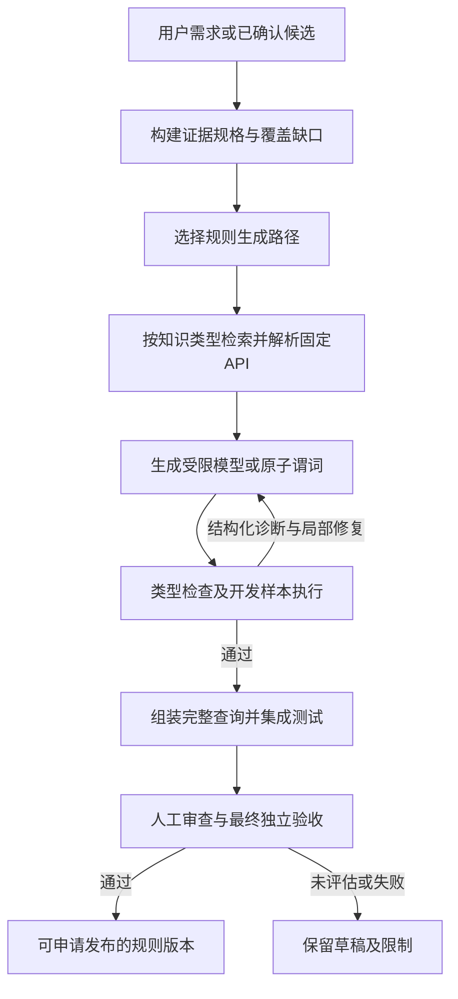

# RAG规则生成改进方案：规格、类型与执行共同约束

日期：2026-10-03。状态：**研究与设计完成，尚未实现本方案**。依据：[论文阅读](rule-generation-paper-review.md)、[上一轮测试](phase-one-test-results.md)、提交b508ebb中的实现。四阶段GUI保持现有概念，本文细化规则生成阶段内部流程。

## 1. 问题判断

36次规则生成只有8次获得可编译草稿；28次失败，其中27次输出不完整。关闭思考模式的三轮完整返回，但仍编译失败。追加API资料的三轮为编译/契约失败，现有记录不足以还原每轮的具体失败步骤，不能全部断言为编译器类型错误。

### 代码与记录中的具体缺口

| 已核对的事实 | 导致的问题 | 修改目标 |
|---|---|---|
| `RuleService.retrieve`主要用整段requirement检索；未按operation、知识类型、框架组织检索 | 一个需求的无关关键词占据检索结果 | 需求结构化，多种知识各取必要条目 |
| 库知识导入标题统一加了“eval SQL XSS” | 自己引入的关键词污染；不能完全归咎于模型 | 重建明确操作标签，保留旧版本供复现 |
| eval实验六条资料前三条为XSS/SQL/CodeInjection Customizations，转换节点声明未进入top6 | 真正需要的类型信息未被取得 | 符号精确查找优先，语义检索用于结构/根因例子 |
| `RuleService.generate`一次要求query/modules/覆盖说明/正反例 | 任务与输出耦合，QL与样本相互迎合 | 把规格、代码及开发样本分步产生 |
| 失败反馈只有错误文本/日志尾部，没有显式上一版query/modules | 模型重新猜方案，不能稳定定位修复 | 完整候选+结构化诊断+相关定义，针对局部修复 |
| 候选提炼传title/description/evidence_ids，未传实际源码和路径 | 从描述重新推测根因 | 从已确认证据构建有位置与快照hash的输入 |
| 失败消息合并编译/契约，部分失败stage缺少可复查候选文件 | 难以解释失败和训练修复器 | 在任何验证前保存生成候选，逐步记录失败类别 |
| 已有独立验收阻止坏规则发布 | 门槛是必要基础，但不直接让模型生成正确 | 保留门槛，增加开发反馈，隔离最终holdout |

上述是项目诊断；论文仅提供改进依据，不替代本地实验。

## 2. 新执行链路

### 2.1 证据规格

`RuleSpec`至少包含：language、purpose、CWE、framework/API、固定依赖、目标语义、source/sink/传播/保护条件、已知基线覆盖、拟补缺口、位置与证据ID、snapshot_hash、不支持的情形。

- 已确认候选：服务读取实际证据内容与有限源码，校验审计归属和当前快照；补丁存在时附带经验证的前后对照，AI生成但未接受的diff不作为修复金标。
- 自然语言：允许只有需求的探索草稿，但缺项目证据时明确标注；没有证据不能声称发现新漏洞/覆盖缺口。
- 每个字段区分observed/inferred/unknown。源码符号、调用位置由工具取得；AI负责提出语义假设。
- 标准Flask/Express eval等若已有基线覆盖，不以重写基线查询充当增益。选择补自定义框架模型或仅生成review_anchor。

### 2.2 三种生成路径

| 路径 | AI输出 | 工具负责 | 适用边界 |
|---|---|---|---|
| A 默认：模型补充 | source/sink/summary等受限JSON规格 | 校验符号与访问路径；版本模板转YAML数据扩展或已验证qll | 已有检测器缺框架API模型 |
| B 常用：扩展谓词 | 有类型签名的source/sink/step/barrier候选 | 模板骨架、固定imports、逐谓词编译/测试、组装 | YAML无法表达但标准数据流可处理 |
| C 高级：新查询 | 小范围查询组件、明确根因假设 | LSP/定义查找、编译器、执行反馈与独立验证 | 状态、控制流等确实超出已有框架的逻辑 |

路径A不是限制AI只能做名字匹配。规格必须包含模块/限定名、参数或返回值、调用绑定及传播语义；常量、遮蔽、别名和净化仍需独立验证。模板通过只保证已支持的语法表达，不保证语义正确。不同生成路径与purpose继续分开。

模型数据扩展先仅支持本地已确认sourceModel/sinkModel/summaryModel；最新官网的barrier功能不直接回移。无成熟模板/表达能力时进入B/C或报告unsupported，不能生成假的框架模型。

### 2.3 分层、按需检索

建立三类语料：

1. **类型/API索引**：完整符号名、receiver/参数/返回类型、导入模块、定义片段、API版本和source hash。优先LSP definition/hover/complete与固定本地库，不只靠embedding。
2. **可运行结构例子**：薄查询、谓词、模型扩展；保存依赖、imports、用途、真实编译/开发测试结果。未经验证的AI草稿不回流为可信知识。
3. **漏洞根因与框架资料**：CWE、受影响版本、框架API语义、限制。检索训练项目的公开修复对照可用，最终测试答案不可入库。

owner/language/API版本继续强过滤；CWE、operation、framework用于路由与排序，允许显式回退到基础类型资料，避免硬CWE过滤丢掉通用DataFlow定义。先做BM25+符号精确检索，embedding存在并通过消融再启用融合。

每轮保存查询子问题、候选排名、原始分数与排序分数、选择理由、资料用途和不足字段。RRF得分只是排序，不当作相关性概率。达到必要API/例子覆盖条件才生成；不足时补取资料或结束为insufficient_knowledge。

### 2.4 类型工具及失败修复

优先复用[QLCoder作者LSP适配器](https://github.com/neuralprogram/codeql-lsp-mcp)或成熟LSP客户端，先做兼容性试验；MCP是可选传输方式，LangGraph节点调用窄接口即可。

- 工具：固定workspace内的definition/hover/complete/diagnostics及compile；不暴露任意shell、任意路径或整个外部代理环境。
- 每个候选在metadata、fixture或编译验证前先落盘，保存query/modules/模型规格及hash。
- 分类失败：generation_truncated、schema_invalid、metadata_invalid、api_symbol_missing、type_mismatch、compile_failed、fixture_invalid、dev_false_positive、dev_false_negative、unsupported_semantics、budget_exhausted。
- 修复输入必须含**当前完整候选、失败位置与诊断、必要定义、原始语义约束**。修复输出为校验可应用的局部变更或完整单个组件；不得顺手重写样本预期、用途、依赖或根因。
- AST Expr、控制流节点、DataFlow::Node等类型区分用实际定义确认；转换策略必须出自当前版本API。
- 开发样本可给具体反例和命中路径；修复目标不能退化成常量文件名/行号/标记文本匹配。

### 2.5 分步输出与预算

建议初始范围：每次只生成一个规格/谓词/模块；说明与样本单独步骤。候选输出预算先试2048–4096，并记录实际推理占比；这是待测配置，不能假定小预算必然更好。语法局部修复最多三次，重复诊断/hash无变化立即停止。

沿用M1逐调用记录与共同预算。内层输出恢复、局部编译修复、组件重试合计，不能分别重置预算。保留24次调用/100000 token作为初期模型总上限；交互任务仍300秒目标，超限明确失败。若离线研究确需更长时间，单独显式配置，不静默延长GUI任务。工具进程超时和总wall-clock也需覆盖，不能仅统计模型时间。

默认模型先保持当前配置；替代模型、思考模式和专用修复器作为后续单因素实验，不据论文结果直接切换。我方端点没有经过验证的模型本地训练权限/权重，LoRA为后期条件路线。

## 3. 评价与数据隔离

### 三层数据

- **知识/训练**：文档、源码、已验证历史组件；按项目/版本/根因去重。
- **开发验证**：合成或人工审查的最小PoC、修复前后对照，可将诊断反馈给生成器。
- **最终测试**：独立、版本固定、按项目/根因隔离的测试，代码/金标不得进入prompt或知识库。最终失败只保留验收结果，不把测试细节送回修复循环。改方案后应使用新外部测试集。

当前12个微样本集保留为历史回归。针对生成器循环调试新增开发集，论文评价另建未使用的跨文件/框架集。未来benchmark的“无法构建/超时/未知”单列，不能作TN。

### 逐步实验

1. 固定当前12项需求×3轮，共36次，复现原始组；比较生成完成率、编译/契约通过率及所有失败。它是已经见过的回归组，不是新泛化测试。
2. 在同语料/模型/预算下：原检索 → 需求路由+符号检索 → 增加LSP。每次只新增一个因素。人工API金标先建立，不包含目标规则答案。
3. 再比较整体生成/原子谓词生成、原反馈/完整候选局部修复；每组同需求、最多同总调用/token/时间。
4. 单独比较A/B/C路径；A支持范围外的任务报告unsupported，不从总体分母删掉。框架集至少新增12个独立需求，涵盖自定义source/sink/传播与净化、别名、遮蔽、跨文件包装。
5. 选择效果最佳方案后，在按项目/根因隔离的最终集验证；传统CodeQL、新规则、CodeQL+新规则分别跑，测新增TP/FP。

### 指标与拟定验收目标

| 维度 | 指标 | 初期拟定目标（不是论文保证） |
|---|---|---|
| 检索 | 必需API Recall@k、MRR、无关操作占位率、版本正确率 | 版本正确100%；每种操作关键定义至少一条进入所选上下文 |
| 生成 | 完整率、首次/修复后编译率、错误分布 | 回归36次整体编译/契约通过率≥80%，由8/36作为基线 |
| 独立验收 | 按purpose的所有需求通过率、TP/FP/FN、未知数 | 初期争取≥60%需求通过；发布规则必须满足既定安全反例门，不以平均分绕过 |
| 泛化增益 | 新增根因TP、新增FP、跨文件/项目通过率 | 至少实证一个基线覆盖缺口；重写已覆盖eval规则不计增益 |
| 稳定性与成本 | 三轮一致性、p50/p95、token、模型/工具耗时 | 与原组同预算比较；超时/不支持保留分母 |

未达到目标就报告无改善，保持草稿能力；不得通过放宽反例、删除失败需求或替换独立集来宣布成功。

## 4. 实施批次、原因与目标

| 批次 | 内容 | 原因 | 完成门 |
|---|---|---|---|
| R0 P0 | 完整候选留存、结构化错误、上一版输入、需求operation与知识标签；实际证据读取 | 当前诊断与输入不完整，最小改动即可修正 | 错误前后可复查；同一错误定向修复；无关操作检索回归通过 |
| R1 P0 | RuleSpec、受限模型路径A、固定模板、开发集 | 降低自由QL负担，复用CodeQL模型机制 | Python/JS模型集成真实运行，常量/遮蔽/别名对照通过；明确unsupported |
| R2 P1 | LSP窄工具、分层知识、谓词生成与局部修复路径B | 类型/API幻觉仍是瓶颈 | 固定包握手/符号/诊断校准；相同语料消融改善真实结果 |
| R3 P1 | 完整查询组合、独立外部集与方法评价 | 编译与开发样本不足以证明有效 | 全失败纳入、根因级增益与新增误报统计；人工发布门保持 |
| R4 条件 | 向量融合、模型专用修复器、LoRA | 需要配置/数据，并存在额外变量 | 仅在前三批稳定后独立验证是否值得投入 |

## 5. 模块边界与兼容

LangGraph拆成 `specify → route → retrieve → model_or_predicates → check → refine → assemble → approve → evaluate`，组件状态持久化ID/hash传递。节点保持薄，沿用SQLModel/Haystack/CodeQL适配器。

- contracts：RuleSpec、ModelSpec、PredicateSpec、Diagnostic与输出动作。
- services：根因证据构建、生成路径选择、组件验证/组装；现有RuleService逐步成为门面，避免继续加长。
- adapters/retrieval：按知识角色路由、精确符号查找；保留现有owner/version过滤。
- adapters/codeql：LSP、模型pack、诊断解析与既有compile/fixture执行。
- persistence：组件候选、版本、父子关系、实际定义引用、开发验证、最终验收及共同预算。
- prompts：规格、组件、修复分别版本化；新workflow版本不影响历史v1/v2恢复。

手写业务文件150–300行为常态。新增YAML模型产物需要升级RuleVersion及指纹：模型数据、模板hash、依赖、purpose、开发/最终数据集hash均纳入；运行必须显式加载对应model pack。不能只把YAML存进数据库却漏接CodeQL。

当前framework_model要求qll模块的校验需随路径A能力版本化变更，只有真实模型集成与完整独立集存在后允许发布。旧未知用途规则保留明确历史标志，不迁移成已通过新方法。

## 6. 论文表述建议

把第一个创新点收敛为“**基于版本化知识与类型/执行反馈的组合式静态规则合成**”。RAG、LSP、模板及组件验证分别已有先例，不能声称首次提出。潜在贡献应来自：对本项目框架缺口的可验证建模、共同预算内的选择性生成，以及跨项目根因增益。是否构成论文贡献，以消融和外部集结果及进一步文献比对为准。

推荐先落地R0/R1，再测R2；暂不把向量库、重排、多个代理、微调一起引入，以免无法判断改进来源。
